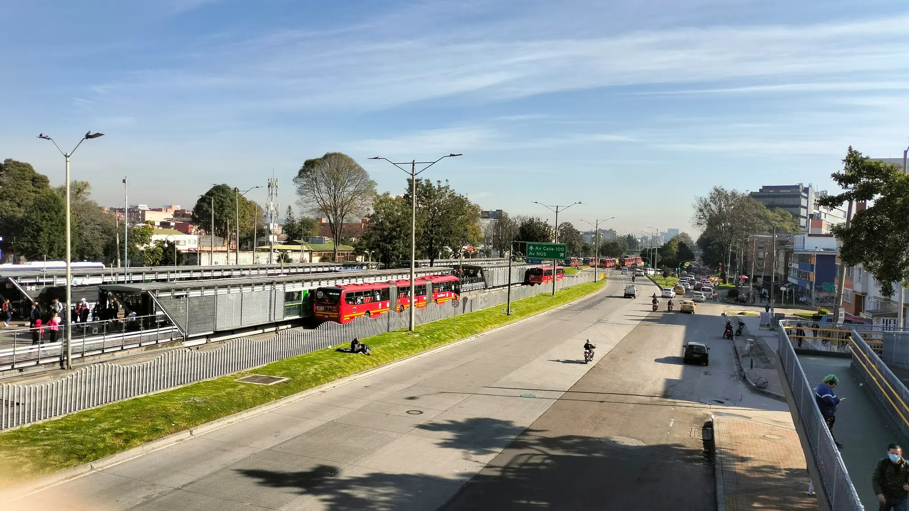

Para muchos compradores en Bogotá, la exención del pico y placa pesa más que cualquier descuento tributario. Por eso la noticia cayó con fuerza en los grupos de dueños de híbridos: el alcalde **Carlos Fernando Galán** confirmó que la excepción para **híbridos y eléctricos** en la reglamentación distrital está vigente **hasta el 31 de diciembre de 2027**, y que su continuidad la decidirá la próxima administración.

Pero la noticia no afecta a los dos grupos por igual.

## Híbridos: la exención depende de la Alcaldía

La excepción de los híbridos es una decisión del Distrito, incluida en los decretos de pico y placa. Por eso tiene fecha de vencimiento y por eso se puede extender, recortar o eliminar. A partir de 2028, los híbridos **podrían volver a tener pico y placa** si el próximo alcalde no la renueva.

Ya hubo una señal: en el **Día sin carro del 5 de febrero de 2026**, los híbridos no pudieron circular en Bogotá. Los eléctricos sí.

## Eléctricos: los protege una ley nacional

El caso de los eléctricos es distinto. La **Ley 1964 de 2019** dice que los vehículos eléctricos y de cero emisiones **no están sujetos a las restricciones de circulación** que fijen las autoridades locales, entre ellas el pico y placa y el día sin carro. La única excepción son las restricciones por razones de seguridad.

Eso significa que una alcaldía no puede quitarles la exención por decreto. Para cambiarla haría falta una reforma de la ley en el Congreso.

*Las exenciones buscan premiar a los carros de menos emisiones, pero su crecimiento las pone bajo presión. Foto: Jesska Forero en Unsplash.*

## Por qué se discute ahora

El éxito de los electrificados es el problema. **Cuatro de cada diez carros nuevos** vendidos en Colombia en el primer semestre de 2026 fueron eléctricos o híbridos, y Bogotá concentra la mayor parte. Con más de 180.000 vehículos inscritos en las excepciones del pico y placa, la medida pierde capacidad para descongestionar.

## Cuánto vale la exención

| Opción | Costo en Bogotá en 2026 |
|---|---|
| Pico y placa solidario por un día | $70.294 |
| Multa por circular en pico y placa | Más de $630.000, más la inmovilización |

Para quien hoy paga el pico y placa solidario varias veces al mes, la exención vale más de un millón de pesos al año.

## Lo que debe hacer si tiene un eléctrico o un híbrido

1. **Inscriba la placa** en la plataforma de vehículos exceptuados de la Secretaría Distrital de Movilidad. La exención no es automática.
2. **Mantenga al día el SOAT y la revisión técnico-mecánica**, porque se verifican en el trámite.
3. **Si está por comprar un híbrido** pensando en el pico y placa, tenga en cuenta que el beneficio podría durar solo hasta 2027.

> Si el pico y placa es su razón principal para cambiar de carro, la diferencia entre un híbrido y un eléctrico ya no es solo de consumo: es de cuánto tiempo dura el beneficio.

## Preguntas frecuentes

### ¿Los híbridos tendrán pico y placa desde 2028?

No está decidido. La exención vence el 31 de diciembre de 2027 y la decisión de extenderla le corresponde a la próxima administración de Bogotá.

### ¿Los eléctricos pueden circular en el Día sin carro?

Sí. La Ley 1964 de 2019 los exime de las restricciones de circulación locales, incluido el Día sin carro, salvo restricciones por seguridad.

### ¿La exención aplica en otras ciudades?

Para los eléctricos, la ley es nacional. Para los híbridos, depende de cada ciudad, así que revise el decreto local.

Compare híbridos y eléctricos en el [comparador de Mejor Eléctrico](/es/comparador/).

---

**Fuentes:** [Portafolio: exención para híbridos y eléctricos hasta 2027](https://www.portafolio.co/economia/regiones/pico-y-placa-en-bogota-hibridos-y-electricos-tendran-exencion-hasta-503940) · [Cambio: los híbridos podrían tener pico y placa desde 2028](https://cambiocolombia.com/pais/articulo/2026/10/los-carros-hibridos-tendran-pico-y-placa-en-bogota-desde-2028-lo-que-podria-cambiar-en-la-ciudad) · [El Carro Colombiano: Día sin carro de febrero de 2026](https://www.elcarrocolombiano.com/movilidad/dia-sin-carro-en-bogota-fecha-oficial-y-el-error-que-le-puede-costar-mas-de-600-000/) · [Infobae: pico y placa solidario y excepciones](https://www.infobae.com/colombia/2026/05/07/conductores-podran-quedar-exentos-del-pico-y-placa-en-bogota-sin-pagar-asi-funciona-el-beneficio-para-2026/) · [Portafolio: cuatro de cada diez carros son electrificados](https://www.portafolio.co/negocios/vehiculo/cuatro-de-cada-10-vehiculos-nuevos-vendidos-en-colombia-ya-son-electricos-o-hibridos-en-499675) · [Ley 1964 de 2019](https://www.alcaldiabogota.gov.co/sisjur/normas/Norma1.jsp?i=85510)
