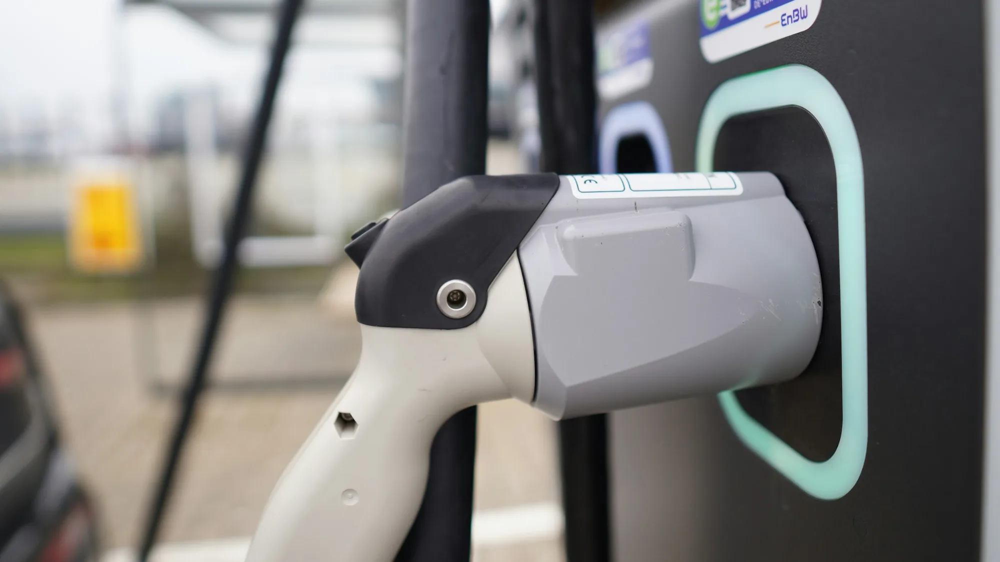

Los eléctricos tienen menos piezas móviles que un carro de gasolina y no necesitan cambios de aceite. Eso no significa que no tengan problemas. Con cerca de 40.000 eléctricos matriculados en Colombia entre enero y septiembre de 2026, y varios años de experiencia acumulada en Europa, ya se puede separar lo que de verdad falla de lo que es mito.

## Lo esencial

- **La batería de tracción rara vez falla.** Los problemas más comunes son de software y de la batería auxiliar de 12 voltios.
- **La carga pública** es la queja número uno en Colombia, con 229 puntos públicos para unos 40.000 eléctricos en mayo.
- **Los talleres preparados** para alto voltaje todavía son pocos.
- **La reventa** es incierta, porque el mercado de usados es muy joven.
- **El riesgo de incendio** es menor que en un carro de gasolina, pero apagarlo es más difícil.

## 1. Software y electrónica

Según estudios de confiabilidad europeos que cita ONMOTOR, sin identificarlos, las fallas de **software y del sistema multimedia** son la primera causa de visitas al taller de los eléctricos, por delante de la suspensión o los frenos. En la práctica son pantallas que se congelan o cámaras que dejan de funcionar. Casi nunca dejan el carro inmóvil, y la mayoría se resuelven con una actualización, pero cada visita al taller le quita al dueño un día de carro.

## 2. La batería de 12 voltios

Es la causa número uno de carros eléctricos varados en muchos modelos: según cifras de asistencia en carretera citadas por ONMOTOR, el **12 % de las llamadas** de eléctricos en el primer trimestre de 2026 fueron por esta batería. Lo explicamos en [nuestra nota sobre la batería de 12 voltios](/es/notas/bateria-12-voltios-carro-electrico-varado/).

## 3. Carga pública insuficiente

En Colombia hay unos **229 puntos de carga públicos** para cerca de **40.000 eléctricos**, unos 174 carros por cargador, según cifras del Ministerio de Minas y Andemos publicadas en mayo. La Agencia Internacional de Energía usa como referencia un cargador por cada diez eléctricos. Con 17 veces más carros por cargador que esa referencia, una estación ocupada se traduce en esperas de varias horas, que es lo que reportan los usuarios. Quien no puede cargar en casa es el más afectado.

*En Europa, solo el 61 % de los cargadores ultrarrápidos entregaba su potencia de forma confiable a comienzos de 2026, según ONMOTOR. Foto: Sophie Jonas en Unsplash.*

## 4. Talleres y repuestos

Las baterías trabajan entre 200 y 800 voltios, y no todos los talleres tienen técnicos ni equipos para tocarlas. En Europa, una pieza de alto voltaje puede tardar unas tres semanas en llegar, así que una falla menor puede dejar al dueño sin carro casi un mes. Lo contamos en [nuestra nota sobre talleres](/es/notas/talleres-reparacion-electricos-800-voltios-colombia/).

## 5. Seguros con menos ofertas

El precio ya no es el problema: asegurar un eléctrico cuesta en porcentaje lo mismo que uno de gasolina. Lo que pasa es que hay **menos aseguradoras** dispuestas a ofrecer póliza, y la cobertura de la batería tiene condiciones. Lo explicamos en [nuestra nota sobre seguros](/es/notas/seguro-carro-electrico-colombia-2026-costo/).

## 6. Autonomía menor a la anunciada

En autopista a 120 km/h, varios eléctricos pierden entre 25 % y 30 % de su autonomía WLTP. En Colombia, las subidas largas pesan más que el frío. Lo detallamos en [nuestra nota sobre autonomía real](/es/notas/autonomia-real-carro-electrico-colombia-montana-autopista/).

## 7. Reventa incierta

En Europa, algunos modelos perdieron hasta 52 % de su valor en tres años. En Colombia todavía no hay datos suficientes. El estado de la batería será el factor que más pese, como contamos en [nuestra nota sobre la batería y la reventa](/es/notas/bateria-carro-electrico-cuanto-cuesta-cambiarla-reventa/).

## Lo que no es un problema tan grande como se cree

- **Que la batería se dañe en pocos años.** Los fabricantes estiman entre 15 y 20 años de vida útil, y la garantía suele ser de 8 años.
- **Los incendios.** Según aseguradoras y bomberos citados por ONMOTOR, un eléctrico tiene unas diez veces menos probabilidad de incendiarse que uno de gasolina. Cuando pasa, eso sí, apagarlo puede requerir hasta 15.000 litros de agua y puede volver a encenderse días después.

> La mayoría de los problemas reales de los eléctricos no están en el carro, sino alrededor de él: cargadores, talleres, seguros y mercado de usados. Antes de comprar, revise esos cuatro frentes en su ciudad.

## Preguntas frecuentes

### ¿Cuál es la falla más común de un carro eléctrico?

Las de software y electrónica, seguidas por la batería de 12 voltios.

### ¿La batería de un eléctrico se daña rápido?

No. Se estima que dura entre 15 y 20 años, con una pérdida de capacidad de alrededor de 1,8 % por año.

### ¿Los eléctricos se incendian más?

No. Se incendian con menos frecuencia que los de gasolina, aunque el fuego es más difícil de apagar.

Compare modelos, garantías y autonomía en el [comparador de Mejor Eléctrico](/es/comparador/).

---

**Fuentes:** [ONMOTOR: problemas reales de los eléctricos en 2026](https://onmotor.es/problemas-reales-en-los-coches-electricos-en-2026/) · [El Colombiano: déficit de cargadores en Colombia](https://elcolombiano.com/negocios/colombia-deficit-cargadores-vehiculos-electricos-estaciones-por-carro-IG36034738) · [Portafolio: talleres y alto voltaje](https://www.portafolio.co/sostenibilidad/baterias-de-hasta-800-voltios-el-reto-de-los-talleres-para-reparar-carros-electricos-e-hibridos-en-colombia-504460) · [La Nota Económica: seguros de eléctricos](https://lanotaeconomica.com.co/movidas-empresarial/el-carro-nuevo-mas-cotizado-para-asegurar-en-colombia-en-2026-es-un-tesla-y-asegurar-un-electrico-ya-cuesta-lo-mismo-que-uno-a-gasolina/) · [Semana: vida útil de las baterías](https://www.semana.com/vehiculos/articulo/marcas-revelan-cuando-duran-y-cuanto-valen-las-baterias-de-los-autos-electricos-que-llegan-a-colombia/202637/)
