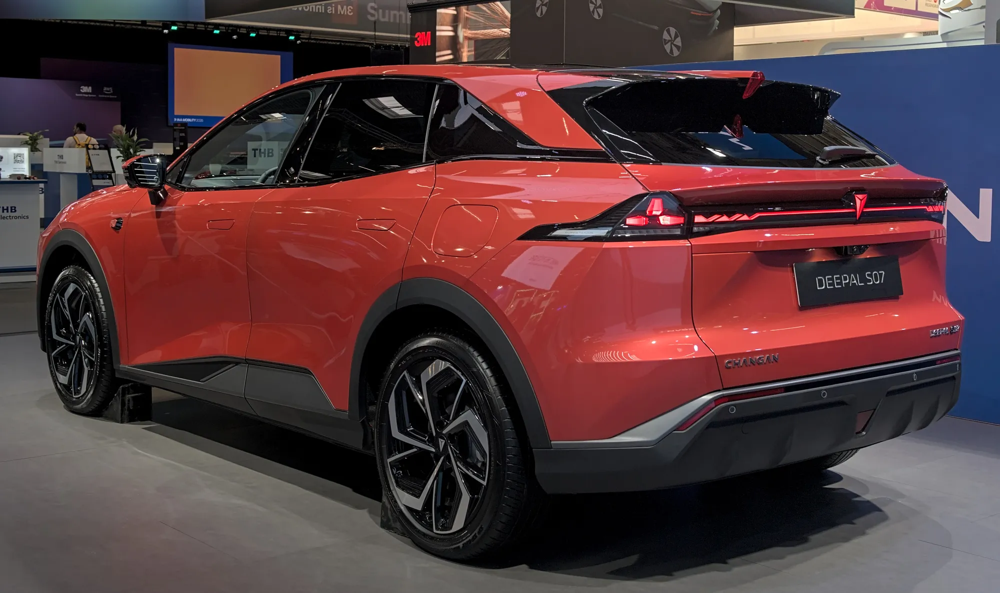

Un carro eléctrico de rango extendido, o **EREV** por su sigla en inglés, es un eléctrico que lleva un pequeño motor de gasolina a bordo. La diferencia con un híbrido es quién mueve las ruedas: en un rango extendido **siempre lo hace el motor eléctrico**. El de gasolina funciona como un generador que recarga la batería cuando se agota, y no está conectado a las ruedas.

## Cómo funciona

El carro sale con la batería cargada y anda como cualquier eléctrico. Cuando la batería baja de cierto nivel, arranca el motor de gasolina, produce electricidad y la batería deja de descargarse. Para quien maneja, la sensación es la de un eléctrico todo el tiempo: aceleración inmediata, sin cambios de marcha, con algo de ruido del motor cuando el generador trabaja.

Por eso las cifras de autonomía vienen dobles. El **Leapmotor C10 de rango extendido**, por ejemplo, tiene una batería de 28,4 kWh, recorre hasta **145 km WLTP solo con electricidad** y, con el tanque lleno, suma **950 km** en total. El **Deepal S07** en su versión de rango extendido usa una batería de 31,73 kWh y declara **1.120 km CLTC** de autonomía total.

*La Deepal S07 se vende en versión eléctrica y de rango extendido; en México, esta última explicó 351 de las 475 ventas de Changan en el primer semestre de 2026. Foto: Alexander Migl, CC BY-SA 4.0, vía Wikimedia Commons.*

## Rango extendido, híbrido enchufable y eléctrico

| | Eléctrico | Rango extendido | Híbrido enchufable |
|---|---|---|---|
| Qué mueve las ruedas | Motor eléctrico | Motor eléctrico, siempre | Motor eléctrico, de gasolina o los dos |
| Motor de gasolina | No tiene | Solo genera electricidad | Puede mover las ruedas |
| Batería en los ejemplos de esta nota | Grande | 28,4 kWh (Leapmotor C10) y 31,73 kWh (Deepal S07) | Varía mucho según el modelo |
| Se enchufa | Sí | Sí | Sí |
| Necesita gasolina | No | Para viajes largos | Para viajes largos y para más potencia |

En la calle, la diferencia entre las dos últimas columnas puede parecer pequeña, porque hay híbridos enchufables que andan buena parte del tiempo en modo eléctrico. Lo que define a un rango extendido es que el motor de gasolina nunca se conecta a las ruedas.

## Ventajas y desventajas

La gran ventaja es para quien no tiene una red de carga confiable en sus rutas. En ciudad, con carga en casa, el carro funciona como un eléctrico y casi no gasta gasolina. En un viaje largo, si no hay electrolinera, basta una estación de gasolina. En países donde la red de carga apenas empieza, como la mayoría de Latinoamérica, ese respaldo pesa.

La desventaja es que se cargan dos sistemas: batería y motor de combustión, con su aceite, su filtro y su mantenimiento. Y cuando el generador trabaja, la gasolina mueve también el peso de la batería, así que el consumo en carretera depende mucho del modelo. La batería, más pequeña que la de un eléctrico puro, también suele cargar más lento en corriente continua: el Leapmotor C10 de rango extendido acepta hasta 65 kW.

## Qué modelos hay en Latinoamérica

En **Colombia**, el Deepal S07 de rango extendido llegó en 2024 con un precio de $155 millones, y Leapmotor anunció para el Salón del Automóvil de 2026, de la mano de Astara, una gama con versiones eléctricas y de rango extendido. En **México**, Changan vendió 475 carros entre enero y junio de 2026, y 351 fueron el Deepal S07 de rango extendido.

> Antes de comprar un rango extendido en Colombia, pregunte cómo queda clasificado en la matrícula. Tiene motor de gasolina, y de esa clasificación dependen beneficios como el IVA reducido o la exención de pico y placa, que se pensaron para los eléctricos puros.

## Preguntas frecuentes

### ¿Un rango extendido es un carro eléctrico?

Funciona como un eléctrico, porque solo el motor eléctrico mueve las ruedas, pero tiene motor de gasolina. Por eso muchas estadísticas lo cuentan aparte, junto a los híbridos enchufables.

### ¿Hay que enchufarlo?

No es obligatorio, pero sin enchufar pierde el sentido: anda casi siempre con el generador y consume gasolina como un híbrido pesado.

### ¿Qué significa EREV o REEV?

Las dos siglas significan lo mismo: vehículo eléctrico de autonomía extendida.

---

**Fuentes:** [Driven: Leapmotor C10 de rango extendido](https://www.drivencarguide.co.nz/news/leapmotor-launches-hybrid-version-of-c10-ev-suv-with-950km-range/) · [Xataka Colombia: Deepal S07 de rango extendido](https://www.xataka.com.co/vehiculos/hibrida-que-promete-autonomia-1-120-km-suv-deepal-s07-caracteristicas-precio) · [El CEO: ventas de electrificados en México, primer semestre de 2026](https://elceo.com/negocios/byd-vende-4-de-cada-10-autos-hibridos-y-electricos-en-mexico/) · [El Carro Colombiano: marcas nuevas para el Salón 2026](https://www.elcarrocolombiano.com/lanzamientos/carros-nuevas-marcas-vienen-colombia-salon-del-automovil-bogota-2026/)
