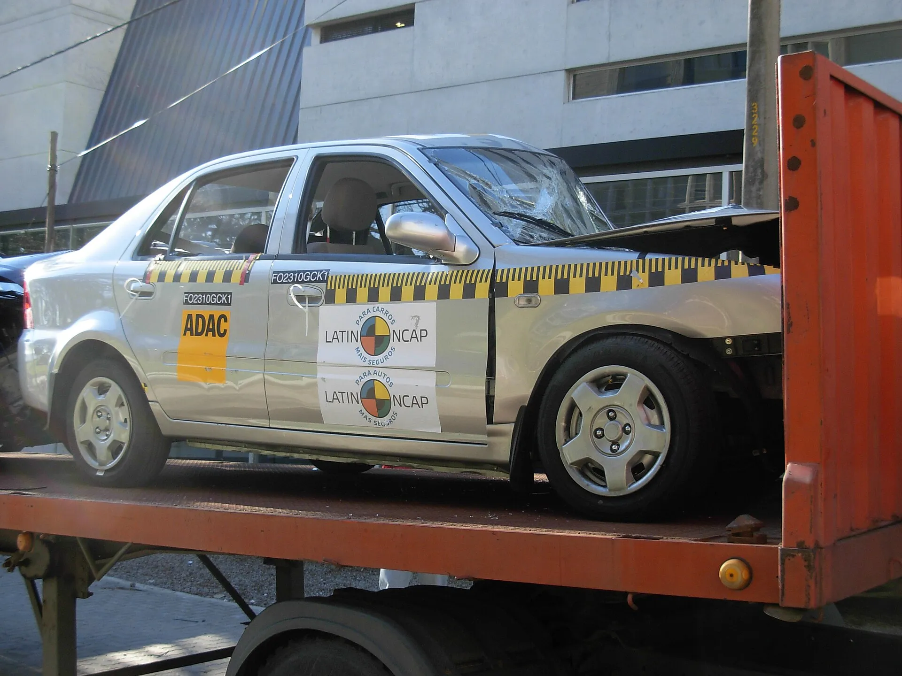

Un crash test, o prueba de choque, es un accidente provocado en un laboratorio para medir qué tanto protege un carro a quienes van adentro y a quienes quedan afuera. El carro choca a una velocidad exacta contra una barrera, o es golpeado por ella, con maniquíes cargados de sensores en los puestos. Lo que registran esos sensores en cabeza, cuello, pecho y piernas se convierte en puntos, y los puntos en estrellas.

En Latinoamérica las dos referencias son **Euro NCAP**, que publica sus primeros resultados desde 1997, y **Latin NCAP**, que evalúa los carros que se venden en la región.

## Los choques que hace Euro NCAP

| Prueba | Velocidad | Qué simula |
|---|---|---|
| Frontal contra barrera móvil deformable | 50 km/h el carro y 50 km/h la barrera, de 1.400 kg | Choque de frente con otro carro, con la mitad del frente comprometida |
| Frontal contra muro rígido | 50 km/h | Choque de frente completo; mide cinturones y airbags |
| Lateral con barrera móvil | 60 km/h | Otro carro que golpea de lado en un cruce |
| Lateral contra poste | 32 km/h | El carro que derrapa y golpea de lado un poste o un árbol |
| Golpe lateral del lado opuesto | En plataforma | Cuánto se desplaza el ocupante hacia el otro lado |
| Latigazo cervical | Impulsos de 16 y 24 km/h | Un golpe por detrás en un trancón |

En el choque frontal contra la barrera móvil van un maniquí avanzado de adulto, llamado THOR, al volante, otro adulto de copiloto y dos maniquíes de niños de 6 y 10 años atrás. En el choque contra muro rígido se usa un maniquí de mujer de baja estatura, porque los airbags y los cinturones deben proteger también a quien se sienta más cerca del timón.

## Las cuatro áreas que deciden las estrellas

Los choques son solo una parte de la nota. Euro NCAP califica cuatro áreas:

1. **Protección de adultos**, con los choques de la tabla.
2. **Protección de niños**, con los maniquíes infantiles y la facilidad para instalar las sillas.
3. **Usuarios vulnerables**, que mide qué tan fuerte golpea el frente del carro a un peatón o a un ciclista, y si el carro frena solo ante ellos.
4. **Asistencias de seguridad**, como el frenado autónomo, el asistente de carril y el asistente de velocidad.

Cada área tiene un mínimo para cada nivel de estrellas. Por eso un carro con una carrocería excelente puede quedarse en cuatro estrellas si no trae de serie las asistencias: le pasó al Kia EV3, que sin su paquete opcional sacó 67 % en asistencias, como contamos en [su nota](/es/notas/kia-ev3-euro-ncap-4-o-5-estrellas/).

*Un Geely CK después de su prueba de Latin NCAP en 2010. Foto: NaBUru38, CC BY-SA 3.0, vía Wikimedia Commons.*

## Latin NCAP: la misma lógica, con carros de la región

Latin NCAP también califica con cuatro pilares: adultos, niños, peatones y usuarios vulnerables, y sistemas de asistencia. La nota final la define el pilar más bajo, así que cinco estrellas exigen buenos resultados en los cuatro. Entre los sistemas que evalúa están el control de estabilidad, el frenado autónomo a baja y alta velocidad, el detector de punto ciego, la alerta de salida de carril y la prueba del alce, una maniobra brusca para esquivar un obstáculo.

La diferencia práctica con Euro NCAP es qué carro se prueba. Latin NCAP evalúa la versión que se vende en la región, con el equipo que trae aquí. Euro NCAP prueba la versión europea, que por ley debe traer frenado autónomo y asistente de carril desde julio de 2024. Por eso un mismo modelo puede tener cinco estrellas en Europa y menos en Latinoamérica, o no tener calificación latinoamericana. Pasó con el [BYD Seagull](/es/notas/byd-seagull-dolphin-surf-euro-ncap-5-estrellas/) y con el [Renault Kwid E-Tech](/es/notas/renault-kwid-e-tech-dacia-spring-euro-ncap-1-estrella/).

## ¿Los carros eléctricos se prueban igual?

Sí. Pasan por los mismos choques y se califican con las mismas cuatro áreas. Euro NCAP también evalúa la información de rescate que el fabricante entrega a los equipos de emergencia, algo que en un eléctrico pesa más porque deben saber cómo actuar con el sistema de alto voltaje.

> Antes de fiarse de una calificación, revise tres cosas: quién hizo la prueba, en qué año y con qué equipo venía el carro probado. Las tres cambian el significado de las estrellas.

## Preguntas frecuentes

### ¿Qué significa crash test?

Prueba de choque. Es un choque controlado en laboratorio para medir la protección de ocupantes y peatones.

### ¿A qué velocidad son las pruebas de choque?

En Euro NCAP, 50 km/h en las frontales, 60 km/h en la lateral con barrera y 32 km/h contra el poste.

### ¿Una prueba europea vale para Colombia?

Solo si el carro que se vende en Colombia trae la misma estructura y el mismo equipo de seguridad que el probado. Compare la ficha de la versión antes de darlo por hecho.

---

**Fuentes:** [Wikipedia: protocolos de prueba de Euro NCAP](https://en.wikipedia.org/wiki/Euro_NCAP) · [La Tercera: el protocolo de cuatro pilares de Latin NCAP](https://www.latercera.com/mtonline/noticia/latin-ncap-endurece-el-protocolo-ahora-evaluable-sobre-cuatro-pilares/FWNAESK5J5BOREUBHNK76QFU5E/) · [Euro NCAP: Kia EV3, calificación de 2025](https://www.euroncap.com/en/results/kia/ev3/54845) · [SIMI: sistemas obligatorios en la Unión Europea desde 2024](https://www.simi.ie/en/road-safety/gsr)
