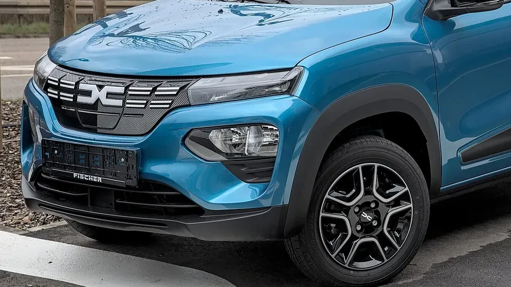

El **Renault Kwid E-Tech** es uno de los eléctricos más baratos de Colombia. En Europa, el mismo carro se vende como **Dacia Spring**, y en diciembre de 2021 **Euro NCAP** le dio **una estrella**, una de las peores calificaciones de los últimos años. La pregunta para quien lo compra hoy es si ese resultado sigue vigente para el Kwid E-Tech renovado. La respuesta corta: el carro mejoró en equipo, pero nadie ha publicado una nueva prueba que lo demuestre.

## Lo esencial

- **Calificación:** 1 estrella, publicada el 8 de diciembre de 2021, para el Dacia Spring de esa época.
- **Protección de adultos:** 49 %.
- **Protección de niños:** 56 %.
- **Usuarios vulnerables:** 39 %.
- **Asistencias a la conducción:** 32 %.
- **Kwid E-Tech en Colombia, 2026:** seis airbags y frenado autónomo de emergencia, según Renault.

## Qué encontró Euro NCAP en 2021

Los resultados fueron malos en casi todas las pruebas:

- En los **choques frontales** hubo riesgo alto de lesiones graves en el **pecho del conductor** y en la **cabeza del pasajero trasero**. El riesgo para las piernas fue alto para todos los ocupantes en la prueba contra la barrera móvil.
- En el **choque lateral**, la protección del pecho fue apenas marginal.
- En **niños**, la cabeza y el cuello del maniquí de 6 años tuvieron protección débil en el choque frontal.
- El **frenado autónomo** tuvo un desempeño marginal y no detectaba peatones ni ciclistas. Tampoco tenía asistente de carril ni detector de cansancio.

Michiel van Ratingen, entonces secretario general de Euro NCAP, dijo que la protección de los ocupantes era peor que la de "cualquier vehículo que hayamos visto en muchos años" y calificó de cínico ofrecer un carro barato y verde a costa de un mayor riesgo de lesiones.

*El Spring renovado cambió el frente y el interior. El Kwid E-Tech colombiano se renovó en 2025. Foto: Alexander Migl, CC BY-SA 4.0, recortada, vía Wikimedia Commons.*

## Qué cambió en el Kwid E-Tech colombiano

En octubre de 2025, Renault presentó en Colombia el Kwid E-Tech renovado, en una sola versión, **Techno**, desde **$72.990.000**. Según la marca, trae:

| Equipo | Kwid E-Tech 2026 en Colombia |
|---|---|
| Airbags | 6: frontales, laterales y de cortina |
| Frenado autónomo de emergencia | Sí |
| Alerta y asistente de mantenimiento de carril | Sí |
| Detector de fatiga | Sí |
| Reconocimiento de señales de velocidad | Sí |
| Cámara de reversa y sensores delanteros y traseros | Sí |

Es bastante más equipo que el que tenía el Spring evaluado en 2021, que en particular no tenía asistente de carril ni detector de cansancio, y cuyo frenado no reconocía peatones.

## Lo que no se sabe

El equipo ayuda, pero la estructura es la que define cómo se protege a los ocupantes en el choque. Ni Euro NCAP ni Latin NCAP han publicado una prueba del Kwid E-Tech o del Spring renovado. Mientras no exista, la única calificación pública es la de una estrella de 2021.

> Si está mirando el Kwid E-Tech, sume a la comparación el resultado de 2021 y el equipo nuevo, pero no asuma una calificación que el carro no tiene. Ni buena ni mala.

## Preguntas frecuentes

### ¿Cuántas estrellas tiene el Renault Kwid E-Tech?

No tiene una calificación propia. Su gemelo europeo, el Dacia Spring, sacó una estrella en Euro NCAP en 2021, con la versión anterior del carro.

### ¿El Kwid E-Tech actual es más seguro?

Trae más equipo: seis airbags, frenado autónomo y asistente de carril. Pero no se ha publicado una prueba de choque que mida cuánto mejoró.

### ¿Cuánto cuesta el Kwid E-Tech en Colombia?

Desde $72.990.000 en la versión Techno, según el lanzamiento de octubre de 2025.

Compare el Kwid E-Tech con otros eléctricos urbanos en el [comparador de Mejor Eléctrico](/es/comparador/?a=renault-kwid-e-tech-techno-2026-co&b=byd-seagull-gl-300-2026-co).

---

**Fuentes:** [Euro NCAP: comunicado sobre el Dacia Spring, diciembre de 2021](https://euroncap.newsmarket.com/latest-release/renault-laguna-s-legacy-ruined-as-zoe-and-spring-debase-electric-car-safety/s/7b157f99-83e7-42b3-a18e-54102dde0bdb) · [The Car Expert: puntajes del Dacia Spring](https://www.thecarexpert.co.uk/dacia-spring-2024/) · [CarDekho: detalle de la prueba](https://www.cardekho.com/india-car-news/dacia-spring-renault-kwid-ev-scores-just-1-star-in-euro-ncap-crash-test-28306.htm) · [Renault Colombia: Kwid E-Tech renovado](https://cdn-prensa.renault.com.co/wp-content/uploads/2025/10/17152750/EL-KWID-E-TECH-EVOLUCIONA-CON-DISENO-MODERNO-TECNOLOGIA-AVANZADA-Y-SEGURIDAD-SUPERIOR.pdf)
