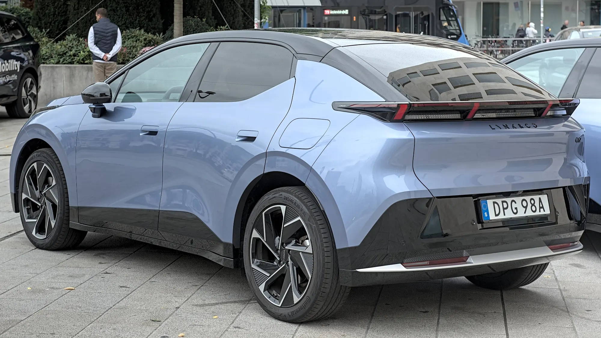

El **Salón Internacional del Automóvil de Bogotá 2026**, en Corferias, será a mediados de noviembre, y llega con **más de 15 marcas nuevas o que regresan** al país, según el conteo de El Carro Colombiano. Casi todas son chinas y casi todas traen eléctricos, híbridos enchufables o de rango extendido.

## Lo esencial

- **Fecha:** mediados de noviembre de 2026, en Corferias. Las fechas exactas no se habían publicado a la hora de escribir esta nota.
- **Marcas nuevas o que regresan:** 16 en el listado de El Carro Colombiano.
- **Origen:** 15 son de grupos chinos; la otra es Cadillac, de General Motors.
- **Grupo con más marcas:** Chery, con Lepas, iCAUR, Jaecoo, Omoda y Soueast.

## Las marcas y sus eléctricos

| Marca | Grupo | Importador | Eléctricos que menciona la marca |
|---|---|---|---|
| Arcfox | BAIC | Magma Automotive | T1, T5 y S5, ya a la venta desde agosto |
| Avatr | Changan | Grupo Vardí | 06, 06T y 12, entre otros |
| Cadillac | General Motors | GM Colmotores | Lyriq, Optiq y Vistiq |
| Denza | BYD | Motorysa | Z9 GT, además de híbridos enchufables |
| Hongqi | FAW | Cóndor Automotor | E-HS5, E-HS7 y E-HS9, sin confirmar |
| iCAUR | Chery | Grupo Vardí | V23, ya a la venta desde septiembre |
| IM Motors | SAIC | Los Coches | IM6 |
| Jaecoo | Chery | Por anunciar | Jaecoo 5 |
| Leapmotor | Leapmotor y Stellantis | Astara | B03, B03X, B10 y C10, eléctricos y de rango extendido |
| Lepas | Chery | Por anunciar | L4 y L6 |
| Lynk & Co | Geely | Por anunciar | 02 |

Llegan además **BAIC**, **212** (de BAW), **Omoda**, **Rox Motor** y **Soueast**, pero con híbridos, versiones de rango extendido o carros de gasolina, no con eléctricos puros.

*El Lynk & Co 02, el eléctrico de la marca de Geely que llegaría a Colombia. Foto: Alexander-93, CC BY-SA 4.0, recortada, vía Wikimedia Commons.*

## Por qué llegan tantas marcas ahora

El mercado eléctrico colombiano creció **221,7 %** entre enero y septiembre de 2026 y ya representa el 17,4 % de las matrículas mensuales. Para las marcas chinas, Colombia se volvió un mercado atractivo por sus condiciones para los eléctricos: aranceles bajos o nulos para eléctricos, IVA del 5 % y exención de pico y placa en varias ciudades.

## Lo que debe mirar quien compra una marca nueva

Una marca que acaba de llegar puede tener buen producto y buenos precios, pero el riesgo está en lo que viene después de la compra:

- **Red de servicio.** Pregunte cuántos talleres autorizados hay en su ciudad.
- **Repuestos.** Pregunte cuánto tarda un repuesto de carrocería o un faro.
- **Garantía de la batería.** Suele ser de 8 años, pero el límite de kilómetros cambia de una marca a otra.
- **Respaldo del importador.** Varias marcas llegan con grupos que ya tienen experiencia, como Vardí, Motorysa, Astara o GM. Otras aún no tienen importador anunciado.

> Más marcas significa más competencia en precio. El riesgo para el comprador aparece si alguna se retira del país: los repuestos se vuelven difíciles de conseguir y el carro pierde valor de reventa.

## Preguntas frecuentes

### ¿Cuándo es el Salón del Automóvil de Bogotá 2026?

A mediados de noviembre de 2026, en Corferias. Las fechas exactas aún no se habían anunciado al publicar esta nota.

### ¿Qué marcas nuevas llegan a Colombia?

Entre otras, Arcfox, Avatr, Cadillac, Denza, Hongqi, iCAUR, IM Motors, Jaecoo, Leapmotor, Lepas y Lynk & Co.

### ¿Cuáles ya están a la venta?

Arcfox, desde agosto, e iCAUR, desde septiembre de 2026.

Compare los eléctricos que ya se venden en el país en el [comparador de Mejor Eléctrico](/es/comparador/).

---

**Fuentes:** [El Carro Colombiano: más de 15 marcas nuevas para el Salón 2026](https://www.elcarrocolombiano.com/lanzamientos/carros-nuevas-marcas-vienen-colombia-salon-del-automovil-bogota-2026/) · [El Carro Colombiano: lanzamientos del segundo semestre](https://www.elcarrocolombiano.com/lanzamientos/carros-nuevos-marcas-lanzamientos-colombia-segundo-semestre-2026/) · [Infobae: eléctricos de enero a septiembre de 2026](https://www.infobae.com/colombia/2026/10/10/crece-la-venta-de-vehiculos-electricos-en-colombia-cerca-de-40000-automotores-en-lo-corrido-del-2026/)
