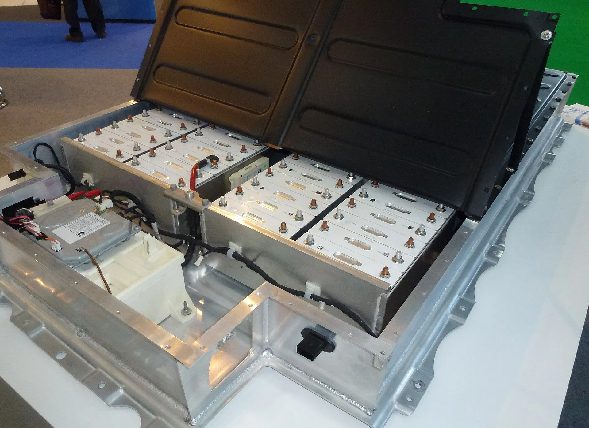

No: con los datos disponibles, los carros eléctricos se incendian **menos** que los de gasolina o diésel. La percepción contraria viene de que un incendio de un eléctrico es noticia y uno de gasolina casi nunca lo es, y de que, cuando una batería arde, el fuego se comporta distinto y es más difícil de apagar. Las dos cosas son ciertas al tiempo.

## Lo que dicen los datos de Suecia

La Agencia Sueca de Contingencias Civiles (MSB) registra los incendios de vehículos según su tipo. En 2022, según sus cifras publicadas por el medio australiano The Driven:

| Tipo de carro | Incendios en 2022 | Parque aproximado | Tasa |
|---|---|---|---|
| Eléctricos | 23 | 611.000 | 0,004 % |
| Gasolina y diésel | Unos 3.400 | 4,4 millones | 0,08 % |

Con esas tasas, un carro de combustión tuvo unas **20 veces más probabilidades** de incendiarse que un eléctrico. Los incendios de eléctricos se mantuvieron en unos 20 por año durante tres años, mientras el parque eléctrico casi se duplicaba.

El dato tiene límites: es un solo país y un solo año, compara por vehículo y no por kilómetro recorrido, y el parque de combustión probablemente es más viejo que el eléctrico, lo que también influye. Aun con esas salvedades, la diferencia es grande.

*La batería de un BMW i3. Cuando una celda de iones de litio se calienta en exceso, puede contagiar a las vecinas. Foto: RudolfSimon, CC BY-SA 3.0, vía Wikimedia Commons.*

## Por qué un incendio de batería es distinto

Cuando una celda de iones de litio se daña o se calienta en exceso, puede entrar en lo que se llama embalamiento térmico: la celda genera su propio calor y contagia a las vecinas. El fuego puede durar horas y reavivarse después de apagado, según explicó a E&E News un profesor de Purdue tras los incendios del huracán Ian. Por eso los fabricantes entregan fichas de rescate, y Euro NCAP evalúa esa información en sus pruebas.

Las baterías de fosfato de hierro y litio (LFP), cada vez más comunes en los eléctricos de precio medio, suelen considerarse más estables ante el calor que las de níquel. Las diferencias las explicamos en [esta nota](/es/notas/bateria-carro-electrico-lfp-nmc-sodio-diferencias/).

## Los casos que sí hay que tomar en serio

Hay situaciones en las que el riesgo sube, y las documentan los propios llamados a revisión:

- **Defectos de fabricación.** En 2026, Volkswagen y Cupra llamaron a revisión eléctricos por un defecto de batería con riesgo de incendio, y MG llamó a revisión 9.806 S5 EV por un ventilador que podía recalentarse con frío extremo. Lo contamos en las notas de [Volkswagen y Cupra](/es/notas/volkswagen-cupra-llamado-revision-baterias-incendio/) y de la [MG S5 EV](/es/notas/mg-s5-ev-problemas-reportados/).
- **Inundaciones con agua salada.** Después del huracán Ian, en 2022, los bomberos de un distrito de Florida apagaron seis incendios de eléctricos que habían quedado bajo agua de mar. Lo explicamos en [carros eléctricos e inundaciones](/es/notas/carro-electrico-lluvia-inundacion/).
- **Choques fuertes que dañan la batería** y reparaciones hechas en talleres sin preparación, como contamos en [esta nota](/es/notas/talleres-reparacion-electricos-800-voltios-colombia/).

## Qué puede hacer el dueño

Atienda cualquier llamado a revisión de su modelo; en Colombia, la Superintendencia de Industria y Comercio publica las campañas de seguridad vigentes. Cargue con cables y cargadores certificados, instalados por un electricista con matrícula. Y si el carro sufre un golpe fuerte en la parte de abajo, donde va la batería, llévelo a revisión aunque parezca que funciona bien.

## Preguntas frecuentes

### ¿Es verdad que los carros eléctricos se incendian más?

No. En Suecia, en 2022, la tasa de incendios de los de combustión fue unas 20 veces mayor que la de los eléctricos.

### ¿Por qué es tan difícil apagar un carro eléctrico?

Porque las celdas de la batería pueden generar su propio calor y contagiarse entre sí. El fuego puede durar horas y reavivarse.

### ¿Qué batería es más segura ante incendios?

Las de fosfato de hierro y litio (LFP) suelen considerarse más estables ante el calor que las de níquel, manganeso y cobalto.

---

**Fuentes:** [The Driven: datos de la MSB de Suecia sobre incendios de vehículos](https://thedriven.io/2023/05/16/petrol-and-diesel-cars-20-times-more-likely-to-catch-fire-than-evs/) · [E&E News: los eléctricos que se incendiaron tras el huracán Ian](https://www.eenews.net/articles/why-6-flooded-evs-burst-into-flames-after-hurricane-ian/) · [Electrive: llamado a revisión de la MG S5 EV](https://www.electrive.com/es/2026/07/20/mg-retira-del-mercado-el-s5-ev-debido-a-un-posible-riesgo-de-incendio/) · [Infobae y EFE: llamado a revisión de Volkswagen y Cupra](https://www.infobae.com/america/agencias/2026/10/16/grupo-volkswagen-llama-a-revision-a-modelos-id-y-de-marca-cupra-por-problemas-en-baterias/) · [Wikipedia: evaluación de rescate en Euro NCAP](https://en.wikipedia.org/wiki/Euro_NCAP)
