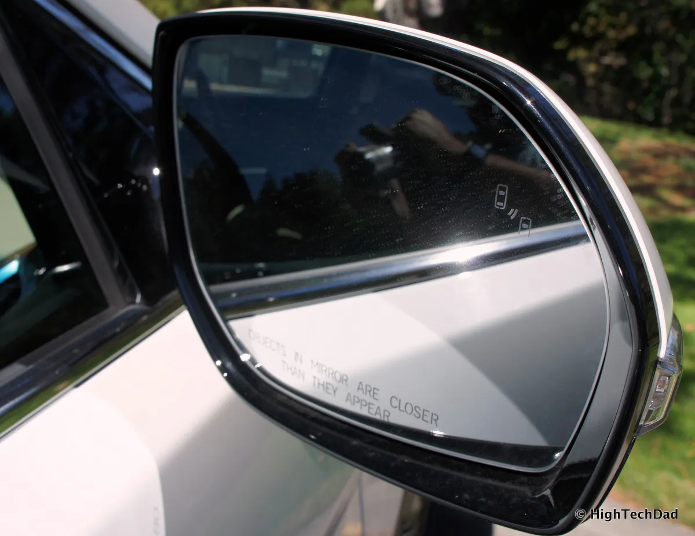

En Latinoamérica se venden muchos más SUV eléctricos que sedanes, así que la lista de berlinas eléctricas es corta. Entre las que sí se consiguen, el monitor de punto ciego no funciona igual en todas. Algunas encienden una luz en el espejo lateral, que es el sistema clásico. Tesla, en cambio, muestra en la pantalla central la imagen de una cámara lateral cuando el conductor pone la direccional.

## Qué traen los sedanes eléctricos

| Sedán | Cómo avisa del punto ciego | Dónde se vende | Fuente del dato |
|---|---|---|---|
| BYD Seal | Luz en el espejo exterior, más alerta de cambio de carril | Colombia, desde 2023 | El Carro Colombiano |
| Tesla Model 3 | Cámara lateral en la pantalla al poner la direccional, con una barra roja si hay un vehículo | Colombia, México y Chile | Manual de Tesla |
| Arcfox S5 | Sin confirmar: la marca habla de "múltiples asistencias", pero no las detalla | Colombia, desde agosto de 2026 | El Carro Colombiano |

El **BYD Seal** que llegó a Colombia en 2023, en versión de doble motor y 516 hp, trae el sistema más completo de la tabla: indicador de punto ciego en el espejo, asistente de cambio de carril, mantenimiento de carril de emergencia, alertas de colisión laterales y traseras y crucero adaptativo, con dos radares adelante y cuatro atrás. Se lanzó en $250 millones.

El **Tesla Model 3** resuelve el punto ciego con cámaras. Según su manual, cuando el conductor activa la direccional, la pantalla muestra la cámara de ese lado y, si detecta un vehículo en el carril de al lado, dibuja una barra roja vertical sobre la imagen. Hay que activar la función en el menú de pantalla. La diferencia práctica es dónde mira el conductor: en la pantalla central, no en el espejo.

El **Arcfox S5**, que llegó a Colombia en agosto de 2026 desde $139,99 millones, es el caso a revisar. Su hermana SUV, la Arcfox T5, sí trae monitor de punto ciego según la marca, pero para el sedán la información publicada solo habla de un equipo "similar". Antes de comprarlo, pida la ficha técnica de la versión.

*El sistema clásico enciende una luz en el espejo lateral cuando hay un vehículo en el punto ciego. Foto: Michael Sheehan, CC BY 2.0, vía Wikimedia Commons.*

## Por qué el punto ciego no viene en todos

En la Unión Europea, el reglamento de seguridad que rige desde julio de 2024 obliga a todos los carros nuevos a traer frenado autónomo y asistente de carril de emergencia, pero el monitor de punto ciego solo es obligatorio para buses y camiones. En los carros de pasajeros queda a criterio de cada marca, y en Latinoamérica tampoco es obligatorio. Por eso es una de las asistencias que más varía entre versiones del mismo modelo.

Latin NCAP sí lo tiene en cuenta: el detector de punto ciego es uno de los sistemas que evalúa en su pilar de asistencias de seguridad.

## Cómo comprobarlo antes de comprar

En la ficha técnica, busque las siglas **BSD** o **BSM** (detección o monitor de punto ciego). Si dice "alerta de cambio de carril" o **LCA**, el sistema también avisa cuando se acerca un vehículo rápido por detrás. En la prueba de manejo, pida al asesor que lo muestre funcionando en una vía de varios carriles: una luz en el espejo y una imagen en la pantalla son experiencias muy distintas.

Si el sedán no es una condición, hay más opciones con punto ciego entre los SUV y los hatchbacks: las reunimos en [esta lista](/es/notas/carros-electricos-pequenos-punto-ciego-asistente-de-carril/).

## Preguntas frecuentes

### ¿Qué berlina eléctrica tiene monitor de ángulo muerto?

Entre las que se venden en Colombia, el BYD Seal lo trae con luz en el espejo, y el Tesla Model 3 con una cámara lateral que se ve en la pantalla.

### ¿El Tesla Model 3 tiene sensor de punto ciego?

Tiene una función de cámara de punto ciego: al poner la direccional muestra la cámara de ese lado en la pantalla y marca con una barra roja si hay un vehículo. No usa la luz clásica en el espejo.

### ¿Qué diferencia hay entre punto ciego y alerta de cambio de carril?

El punto ciego avisa de un vehículo que ya está a su lado. La alerta de cambio de carril también avisa de uno que se acerca rápido por detrás.

---

**Fuentes:** [El Carro Colombiano: BYD Seal en Colombia](https://www.elcarrocolombiano.com/lanzamientos/byd-seal-colombia-sedan-electrico-deportivo-precio-datos/) · [Tesla: manual del Model 3, cámara de punto ciego](https://www.tesla.com/ownersmanual/2017_2023_model3/en_ae/GUID-682FF4A7-D083-4C95-925A-5EE3752F4865.html) · [El Carro Colombiano: Arcfox en Colombia](https://www.elcarrocolombiano.com/lanzamientos/arcfox-colombia-carros-electricos-premium-t1-s5-t5-precios-datos/) · [Autos de Primera: lanzamiento de Arcfox](https://autosdeprimera.com/noticias/noticias-nacionales/arcfox-lanzamiento-colombia-2026/) · [SIMI: sistemas obligatorios en la Unión Europea](https://www.simi.ie/en/road-safety/gsr) · [La Tercera: protocolo de Latin NCAP](https://www.latercera.com/mtonline/noticia/latin-ncap-endurece-el-protocolo-ahora-evaluable-sobre-cuatro-pilares/FWNAESK5J5BOREUBHNK76QFU5E/)
