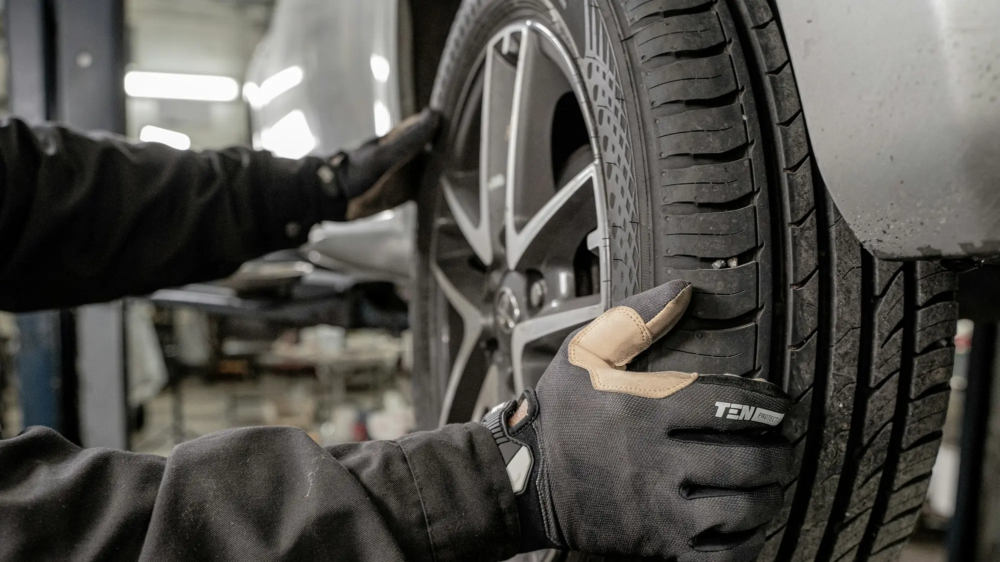

En 2026, los híbridos y eléctricos superaron por primera vez la mitad de las matrículas de un mes en Colombia. El parque crece rápido, pero los talleres preparados para repararlos no crecen al mismo ritmo. El problema no es solo de conocimiento: es de **seguridad**, porque un eléctrico trabaja con voltajes que pueden matar.

## Lo esencial

- **Voltaje de las baterías:** entre 200 y 800 voltios, frente a 12 voltios de la batería de un carro de gasolina.
- **Riesgos de una mala reparación:** descargas eléctricas, quemaduras, incendio de las celdas de litio y daños en los módulos electrónicos.
- **Lo que recomienda Cesvi:** zona de alto voltaje señalizada, área de cuarentena para carros dañados, equipo de protección y herramientas aisladas.
- **Repuestos:** en Europa, una pieza para un eléctrico puede tardar unas tres semanas, frente a tres días para uno de gasolina.

## Por qué un eléctrico es distinto en el taller

La batería de tracción va integrada en el piso del carro y se conecta con cables de alto voltaje que recorren la carrocería. Según Cesvi Colombia, un golpe que parece menor en el piso o en los largueros puede dañar la carcasa de la batería o desalinear los puntos donde está anclada. Si el taller no lo revisa, el daño puede aparecer después, como una falla o, en el peor caso, un incendio.

El mismo riesgo aplica a los **híbridos**, que también tienen baterías y cables de alto voltaje.

*Los técnicos que trabajan con alto voltaje deben usar guantes dieléctricos clase 00, careta y calzado aislante. Foto: Jimmy Nilsson Masth en Unsplash.*

## Lo que debe tener un taller preparado

Según las recomendaciones de Cesvi que recogió Portafolio:

| Requisito | Para qué sirve |
|---|---|
| Zona de alto voltaje señalizada | Que nadie sin formación toque el carro mientras está energizado |
| Área de cuarentena | Aislar un carro chocado por si la batería se calienta o se incendia |
| Guantes aislantes clase 00, careta, calzado aislante y ropa ignífuga | Proteger al técnico de descargas y quemaduras |
| Herramientas aisladas, multímetro categoría III y probador de aislamiento | Verificar que el sistema está desenergizado antes de trabajar |
| Equipos homologados para calibrar asistencias | Dejar bien el frenado autónomo y las cámaras después de un choque |

## El costo de no estar preparado

En Europa, según ONMOTOR, una falla en el inversor, en el módulo de control de carga o en un conector de alto voltaje puede superar los **3.000 euros** fuera de garantía, y en algunas zonas solo hay un concesionario por marca habilitado para trabajar en alto voltaje, con esperas de hasta tres semanas. En Colombia, con más de 15 marcas nuevas llegando en 2026, la red de talleres de cada marca es un dato clave antes de comprar.

> Antes de dejar su eléctrico en un taller que no es del concesionario, pregunte si tienen técnicos certificados en alto voltaje y una zona señalizada para estos carros. Si no saben responder, busque otro.

## Preguntas frecuentes

### ¿Cualquier taller puede reparar un carro eléctrico?

Para mantenimiento básico, como llantas o frenos, muchos sí. Para cualquier trabajo que toque la batería, los cables naranjas o la electrónica de potencia, solo talleres con técnicos formados en alto voltaje.

### ¿Por qué es peligroso?

Porque las baterías trabajan entre 200 y 800 voltios. Un error puede causar una descarga, quemaduras o un incendio.

### ¿Qué pasa si choco mi eléctrico?

Pida que revisen la batería y sus anclajes aunque el golpe parezca menor, sobre todo si fue en la parte de abajo del carro.

Compare la red de servicio y la garantía de cada marca antes de comprar, y revise los modelos en el [comparador de Mejor Eléctrico](/es/comparador/).

---

**Fuentes:** [Portafolio: el reto de los talleres con baterías de hasta 800 voltios](https://www.portafolio.co/sostenibilidad/baterias-de-hasta-800-voltios-el-reto-de-los-talleres-para-reparar-carros-electricos-e-hibridos-en-colombia-504460) · [Infobae: híbridos y eléctricos superan la mitad de las matrículas](https://www.infobae.com/colombia/2026/10/10/crece-la-venta-de-vehiculos-electricos-en-colombia-cerca-de-40000-automotores-en-lo-corrido-del-2026/) · [ONMOTOR: problemas reales de los eléctricos en 2026](https://onmotor.es/problemas-reales-en-los-coches-electricos-en-2026/)
