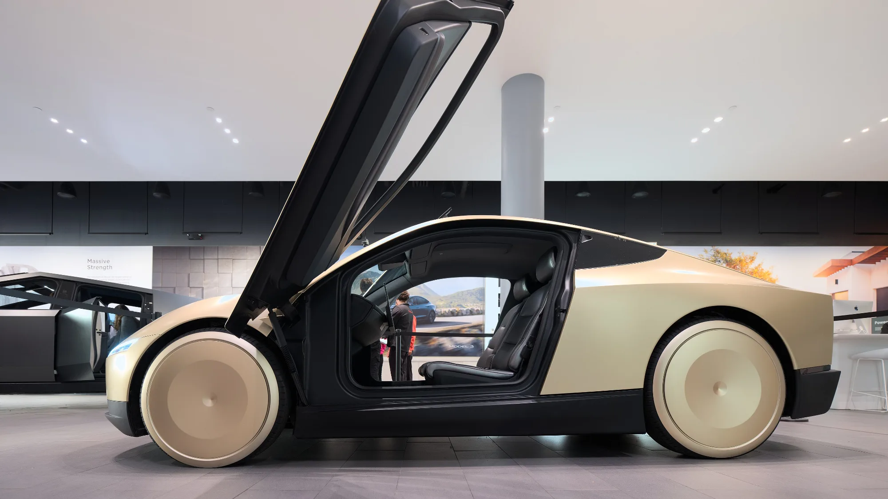

El **Cybercab**, el robotaxi de Tesla sin timón ni pedales, ya sale de la línea de producción en la fábrica de Austin, Texas. En la presentación del Roadster, el 15 de octubre de 2026, Musk incluso lo puso entre los carros que el deportivo saltó con sus propulsores. Pero entre fabricarlo y verlo funcionar solo en las calles hay una distancia que Tesla todavía no recorre.

## Lo esencial

- **Inicio de producción:** el primer Cybercab salió en febrero de 2026 y la producción continua empezó en abril, en Giga Texas.
- **Producción en volumen:** Tesla reconoció en julio que **no la alcanzará en 2026**.
- **Conducción sin supervisión:** aún no resuelta. Musk habló de llevarla a los carros de clientes “probablemente” en el cuarto trimestre.
- **Diseño:** dos puestos, sin timón ni pedales.
- **Motor:** uno, delantero, de unos 219 hp, según documentos presentados ante la EPA.

## Qué dijo Tesla

En la carta a accionistas del segundo trimestre, publicada en julio, Tesla dijo que el Cybercab, el camión Semi y el Megapack 3 ya no llegarán a producción en volumen en 2026, como había prometido en enero. Una de las razones es que necesita aumentar la fabricación de sus celdas de batería 4680.

La inversión se disparó: Tesla espera gastar unos **25.000 millones de dólares** en 2026, cerca del triple de lo habitual, y tuvo un flujo de caja libre negativo de 1.000 millones en el segundo trimestre.

*Las puertas del Cybercab abren hacia arriba, en forma de mariposa. Foto: Dllu, CC BY-SA 4.0, recortada, vía Wikimedia Commons.*

## El problema de fondo: que maneje solo

El Cybercab solo tiene sentido si se conduce sin una persona a bordo, y eso todavía no está resuelto. Según Electrek, el servicio de robotaxi que Tesla opera hoy con carros supervisados tiene una tasa de choques de unas **cuatro veces** la de un conductor humano promedio. El Cybercab, por ahora, solo opera en pilotos pequeños dentro de zonas delimitadas.

Hay también un tema regulatorio. En Estados Unidos, los carros que no cumplen todas las normas federales de seguridad, por ejemplo por no tener timón, necesitan una excepción que tiene un tope de 2.500 unidades al año por fabricante. Tesla sostiene que el Cybercab está diseñado para cumplir las normas sin esa excepción.

> Las fechas de Tesla para la conducción autónoma se han corrido muchas veces. La de un Cybercab funcionando sin supervisión es, por ahora, una meta, no un hecho.

## ¿Llegará a Colombia?

No hay ningún anuncio. Colombia tampoco tiene hoy un marco legal para que circulen carros sin timón ni pedales, así que su llegada dependería primero de un cambio en la regulación de tránsito.

## Preguntas frecuentes

### ¿El Tesla Cybercab ya se fabrica?

Sí. La producción continua empezó en abril de 2026 en Texas, aunque a bajo volumen.

### ¿Cuándo funcionará sin conductor?

Tesla no tiene una fecha firme. Musk habló del cuarto trimestre de 2026 para la conducción sin supervisión, pero la marca ha incumplido fechas similares antes.

### ¿Cuánto cuesta?

Tesla no ha publicado un precio oficial de venta.

### ¿Se venderá en Colombia?

No hay anuncio, y la regulación colombiana no tiene hoy un marco para carros sin timón.

Mientras tanto, compare los Tesla que sí se venden aquí en el [comparador de Mejor Eléctrico](/es/comparador/?a=tesla-model-y-rwd-2026-eu&b=tesla-model-3-rwd-2026-eu).

---

**Fuentes:** [Electrek: arranca la producción del Cybercab](https://electrek.co/2026/04/23/tesla-cybercab-production-starts-no-nhtsa-2500-vehicle-cap/) · [TechCrunch: se aplaza la producción en volumen](https://techcrunch.com/2026/07/22/tesla-spending-skyrockets-as-cybercab-semi-megapack-production-timeline-slips/) · [Wikipedia: Tesla Cybercab](https://en.wikipedia.org/wiki/Tesla_Cybercab) · [TechCrunch: presentación del Roadster](https://techcrunch.com/2026/10/15/tesla-reveals-spacex-powered-roadster-that-flies-and-falls-with-style/)
