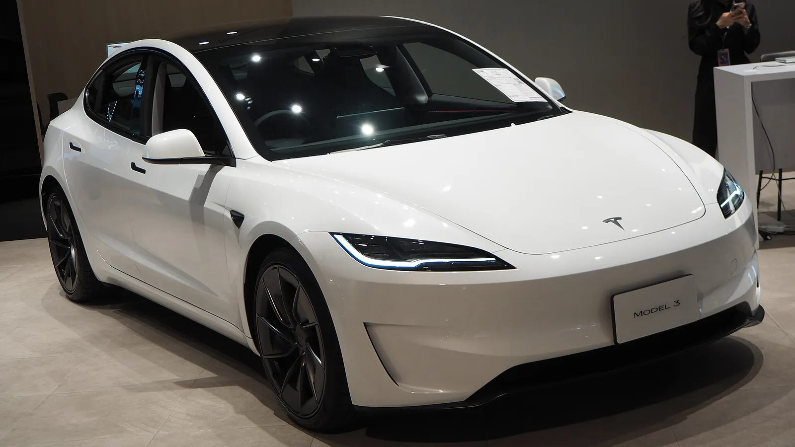

Tesla entregó **486.532 carros** entre julio y septiembre de 2026. La cifra le ganó al consenso de 24 analistas que la propia marca recopiló, que esperaba 461.974, y también a cada una de las estimaciones individuales publicadas. Pero hay una lectura menos optimista: es **2,1 % menos** que en el mismo trimestre de 2025, que sigue siendo el récord histórico de la marca.

## Lo esencial

- **Entregas:** 486.532, 2,1 % menos que en el tercer trimestre de 2025.
- **Frente al trimestre anterior:** 1,3 % más que en el segundo trimestre de 2026.
- **Producción:** 464.391, unas 22.000 menos que las entregas.
- **Model 3 y Model Y:** 478.237 entregas, el 98 % del total.
- **Otros modelos:** 8.295, la mitad que hace un año.
- **Acumulado del año:** 1.324.681 entregas, 8,8 % más que en 2025.

## Por qué cayó frente a 2025

La comparación tiene trampa. En el tercer trimestre de 2025, los compradores de Estados Unidos se apuraron para aprovechar el crédito tributario federal de 7.500 dólares, que terminó el 30 de septiembre de ese año. Eso infló las ventas de entonces.

Según Electrek, lo que sostuvo las cifras de este año fue el **alto precio de la gasolina** en Estados Unidos, que recuperó buena parte de la demanda perdida al acabarse el crédito. En China, las exportaciones desde la fábrica de Shanghái compensaron unas ventas locales débiles.

*El Model 3, el otro carro que sostiene las ventas de Tesla. Foto: Chanokchon, CC BY-SA 4.0, vía Wikimedia Commons.*

## Inventario y almacenamiento de energía

Tesla vendió más carros de los que produjo por segundo trimestre seguido. Con eso terminó de despejar los cerca de 50.000 carros de más que fabricó en el primer trimestre.

En **baterías estacionarias** instaló 13,7 GWh, 9,6 % más que hace un año. Quedó por debajo de los 15,9 GWh que esperaban los analistas, así que el negocio de energía, que Tesla presenta como su otro motor de crecimiento, no compensó la caída en carros.

## La competencia

En el mismo trimestre, **BYD vendió unos 276.000 eléctricos más que Tesla** en el mundo, según Electrek. La distancia ya no es de liderazgo disputado: BYD sacó una ventaja de más de la mitad del volumen de Tesla en un solo trimestre. A eso se suman ganancias por debajo de lo esperado en el segundo trimestre y una línea de crédito de 30.000 millones de dólares, una combinación que presiona sus finanzas justo cuando aumenta la inversión en robotaxis y baterías.

## ¿Y en Colombia?

En Colombia, Tesla va en la dirección contraria a la del mercado mundial: entre enero y septiembre de 2026 matriculó **16.542 eléctricos**, el 41,6 % del total del país, y el Model Y es el carro eléctrico más vendido por amplio margen. Lo contamos en [¿Cuántos Tesla se han vendido en Colombia?](/es/notas/cuantos-tesla-se-han-vendido-en-colombia/).

Una caída de 2 % frente a un récord no es una crisis. Pero los “otros modelos” (Model S, Model X y Cybertruck) cayeron a la mitad en un año, así que hoy el 98 % de las ventas depende de dos carros que llevan varios años en el mercado.

## Preguntas frecuentes

### ¿Cuántos carros entregó Tesla en el tercer trimestre de 2026?

486.532, según el reporte que publicó el 2 de octubre.

### ¿Fue mejor o peor que en 2025?

Peor por 2,1 %, aunque superó lo que esperaban los analistas.

### ¿Qué modelos vende más?

El Model 3 y el Model Y, que sumaron 478.237 entregas.

Compare el Model Y y el Model 3 en el [comparador de Mejor Eléctrico](/es/comparador/?a=tesla-model-y-rwd-2026-eu&b=tesla-model-3-rwd-2026-eu).

---

**Fuentes:** [Electrek: entregas del tercer trimestre de 2026](https://electrek.co/2026/10/02/tesla-q3-2026-deliveries-486532/) · [Drive Tesla Canada: resultados frente a pronósticos](https://driveteslacanada.ca/news/tesla-q3-2026-deliveries-results/) · [Infobae: eléctricos en Colombia, enero a septiembre](https://www.infobae.com/colombia/2026/10/10/crece-la-venta-de-vehiculos-electricos-en-colombia-cerca-de-40000-automotores-en-lo-corrido-del-2026/)
