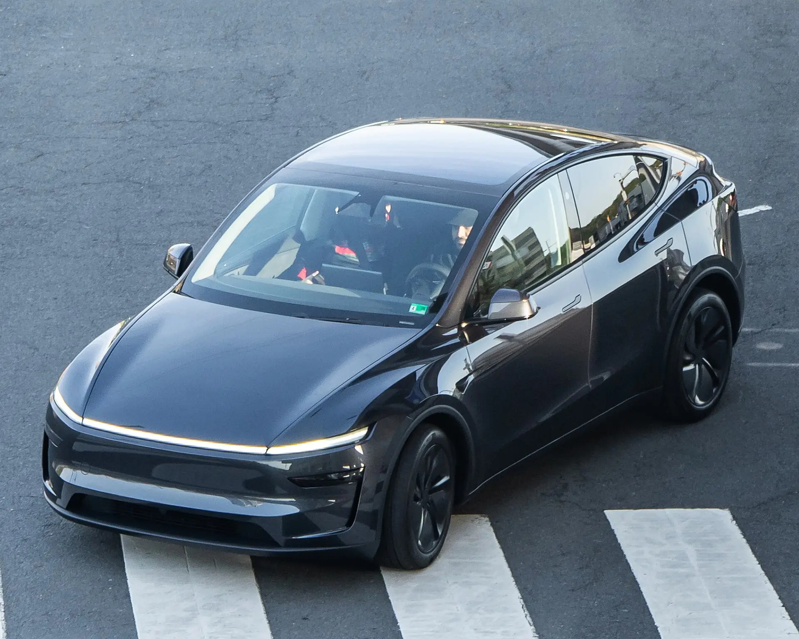

Tesla anunció el 23 de octubre de 2026 una financiación al **0 % de interés** en Colombia para el **Model 3** y el **Model Y** nuevos, con crédito de **Banco Santander**. La condición que más filtra es la cuota inicial: hay que pagar **al menos el 50 % del carro de contado**, y el resto se divide en hasta 36 cuotas sin intereses.

## Las condiciones

| Condición | Detalle |
|---|---|
| Tasa | 0 % efectiva anual fija |
| Cuota inicial | Mínimo el 50 % del precio, de contado |
| Plazo | Hasta 36 meses |
| Entidad | Banco Santander Colombia, que aprueba o niega el crédito |
| Quién puede | Solo personas naturales, no empresas |
| Modalidad | Préstamo tradicional, solo para carros nuevos |
| Fecha límite | Pedidos entre el 22 de octubre y el 31 de diciembre de 2026, con entrega antes del 31 de diciembre |

## Cuánto quedan las cuotas

| Modelo | Precio | Cuota inicial | 36 cuotas de |
|---|---|---|---|
| Model 3 Premium RWD | $115.990.000 | $57.995.000 | Unos $1.610.972 |
| Model Y | $120.990.000 | $60.495.000 | Unos $1.680.417 |

Simulaciones publicadas por Tesla y recogidas por Portafolio. Los precios incluyen IVA, transporte y gastos de registro. Las cuotas no incluyen seguros ni otros cargos, y no equivalen a una aprobación.

La cuenta es sencilla: como no hay interés, cada cuota es el saldo dividido entre 36. Frente a un crédito vehicular tradicional, que en 2026 se ofrecía para eléctricos desde tasas de alrededor del 12,5 % anual, el ahorro es grande: financiar $58 millones a 36 meses al 12,5 % efectivo anual costaría unos $11,2 millones en intereses, según nuestro cálculo, sin contar seguros.

*La oferta exige recibir el carro antes del 31 de diciembre de 2026. Foto: OWS Photography, CC BY 4.0, vía Wikimedia Commons.*

## La letra pequeña

**El 0 % no es costo cero.** Tesla advierte que pueden aplicar seguros, comisiones, garantías y otros cargos, que deben informarse antes de la aprobación. La cifra para comparar es el costo total del crédito, no la tasa.

**La fecha límite es la entrega.** La oferta exige recibir el carro antes del 31 de diciembre de 2026. Tesla tuvo en 2026 retrasos de entrega en Colombia: la Superintendencia de Industria y Comercio informó en abril que más de 1.800 carros que debían entregarse entre febrero y marzo seguían pendientes. Un pedido de finales de año podría quedar por fuera si el carro no llega a tiempo. Pregunte la fecha estimada de entrega antes de firmar.

**No es para todos los bolsillos.** La oferta sirve a quien ya tiene unos $58 a $60 millones disponibles. Para quien no los tiene, Tesla ofrece otros planes de 12 a 60 meses con iniciales desde el 10 %, pero esos sí cobran interés, con tasas que dependen del plazo, la cuota inicial y el perfil del cliente.

## ¿Conviene?

Para quien ya tenía decidido un Tesla y tiene la mitad del dinero, sí: es difícil encontrar un crédito más barato. Para quien estaba comparando, la oferta acorta la distancia de precio con rivales chinos más baratos, pero no la elimina. Un Model Y de $120,99 millones al 0 % sigue costando bastante más que una [Geely EX5 SE](/es/notas/geely-ex5-se-colombia-precio-autonomia-ficha/) de $92,9 millones pagada de contado.

> La oferta es también una señal de mercado: Tesla domina las ventas de eléctricos en Colombia, y usar el crédito para cerrar el año sugiere que quiere sostener ese volumen en el último trimestre. Las cifras de la marca están en [cuántos Tesla se han vendido en Colombia](/es/notas/cuantos-tesla-se-han-vendido-en-colombia/).

## Preguntas frecuentes

### ¿Cuál es la cuota de Tesla al 0 % en Colombia?

Unos $1.610.972 al mes para el Model 3 Premium RWD y $1.680.417 para el Model Y, durante 36 meses, después de pagar el 50 % de contado.

### ¿Hasta cuándo es la financiación al 0 % de Tesla?

Para pedidos hechos entre el 22 de octubre y el 31 de diciembre de 2026, con entrega antes del 31 de diciembre.

### ¿Con qué banco es el crédito?

Con Banco Santander Colombia, que estudia y aprueba cada solicitud.

---

**Fuentes:** [Portafolio: financiación al 0 % de Tesla en Colombia](https://www.portafolio.co/negocios/vehiculo/tesla-ofrece-financiacion-al-0-de-interes-en-colombia-para-model-3-y-model-y-asi-puede-acceder-505120) · [Semana: modelos con tasa del 0 %](https://www.semana.com/vehiculos/articulo/que-modelos-de-tesla-reciben-tasa-de-0-en-colombia-estos-son-los-beneficiados/202643/) · [Valora Analitik: Tesla ofrece financiación al 0 %](https://www.valoraanalitik.com/tesla-ofrece-financiacion-al-0-para-sus-carros-model-3-y-model-y-en-colombia/) · [Portafolio: tasas de crédito para eléctricos en 2026](https://www.portafolio.co/negocios/vehiculo/carros-electricos-ganan-terreno-en-colombia-por-tasas-bajas-iva-reducido-y-alivios-tributarios-493822)
