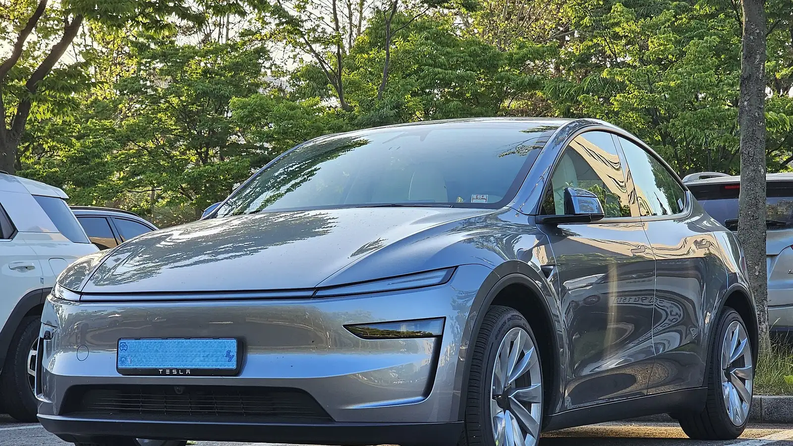

El carro eléctrico más vendido de Colombia también es uno de los mejor calificados en seguridad. **Euro NCAP**, el programa europeo que choca carros nuevos y publica sus resultados, le dio **cinco estrellas** al **Tesla Model Y** de la generación renovada en su última ronda de 2025, publicada el 19 de noviembre de ese año. En enero de 2026 lo eligió además el mejor SUV pequeño evaluado en 2025.

## Lo esencial

- **Calificación:** 5 estrellas, protocolo 2025.
- **Protección de adultos:** 91 %.
- **Protección de niños:** 93 %, el puntaje más alto de su grupo de 23 carros, empatado con otros dos.
- **Usuarios vulnerables** (peatones, ciclistas y motociclistas): 86 %.
- **Asistencias a la conducción:** 92 %, el mejor puntaje de toda la ronda.
- **Peso del carro evaluado:** 1.979 kg.

## Cómo se lee una calificación de Euro NCAP

Euro NCAP no da una nota única. Califica cuatro áreas por separado y la cantidad de estrellas depende de que el carro pase un mínimo en **todas**. Por eso un carro con un puntaje altísimo en una área puede quedarse en cuatro estrellas si falla en otra.

Las pruebas incluyen un choque frontal contra una barrera móvil que simula otro carro, un choque frontal contra un muro, un impacto lateral de otro vehículo y un impacto lateral contra un poste. A eso se suman pruebas de frenado autónomo frente a carros, peatones, ciclistas y motos, y la revisión de sistemas como el monitor del conductor.

## Dónde se destacó

El salto más grande frente al Model Y anterior está en las **asistencias**. Según la cobertura de la prueba, Tesla mejoró el frenado autónomo de emergencia y añadió detección de distracción y de microsueño del conductor con actualizaciones de software, sin cambiar sensores. Eso le dio un **92 %**, por encima del Volvo EX90, que sacó 86 % en la misma ronda.

En **niños**, Euro NCAP le dio la puntuación completa en los choques con los maniquíes de 6 y 10 años, y todas las sillas infantiles recomendadas se pudieron instalar bien. El carro trae además un **radar dentro de la cabina** que avisa si un niño queda olvidado en la silla trasera, uno de los puntos que el protocolo de 2025 premia.

*El frente del Model Y renovado, sin parrilla y con la franja de luz de lado a lado. Foto: Damian B Oh, CC BY-SA 4.0, vía Wikimedia Commons.*

## Frente a otros carros de la misma ronda

| Carro | Adultos | Niños | Vulnerables | Asistencias |
|---|---|---|---|---|
| Tesla Model Y | 91 % | 93 % | 86 % | 92 % |
| Volvo EX90 | 92 % | 93 % | 82 % | 86 % |
| BYD Seal 6 | 92 % | 90 % | 84 % | 85 % |
| Škoda Elroq | 90 % | 87 % | 77 % | 78 % |
| Kia EV5 | 83 % | 85 % | 74 % | 80 % |

Todos los de la tabla recibieron cinco estrellas. La diferencia del Model Y no está en los choques, donde varios rivales lo igualan o lo superan por un punto, sino en la tecnología que evita el choque.

## Lo que hay que tener en cuenta en Colombia

La prueba se hizo con un carro de especificación europea. El Model Y que Tesla vende en Colombia es de la misma generación y la estructura es la misma, pero conviene revisar en la ficha de compra que el equipo de asistencias sea el mismo, porque Tesla define funciones por mercado y por software.

> El puntaje de asistencias depende en buena parte del software. Es una fortaleza, porque mejora con actualizaciones, pero también significa que vale la pena confirmar qué funciones están activas en la versión colombiana.

## Preguntas frecuentes

### ¿Cuántas estrellas tiene el Tesla Model Y en Euro NCAP?

Cinco estrellas, en la evaluación publicada el 19 de noviembre de 2025 para la generación renovada.

### ¿Qué puntaje sacó en protección de niños?

93 %, el más alto de su ronda, junto con el Volvo EX90 y el Lucid Gravity.

### ¿La calificación aplica al Model Y que se vende en Colombia?

Es la misma generación del carro. La estructura no cambia, pero algunas asistencias dependen del software habilitado en cada país.

### ¿Tiene calificación de Latin NCAP?

No. Latin NCAP no ha publicado una prueba del Model Y.

Compare el Model Y con el Model 3 en el [comparador de Mejor Eléctrico](/es/comparador/?a=tesla-model-y-rwd-2026-eu&b=tesla-model-3-rwd-2026-eu).

---

**Fuentes:** [Euro NCAP: resultados de 23 carros nuevos, noviembre de 2025](https://cdn.euroncap.com/en/press-media/press-releases/euro-ncap-announces-test-results-for-23-new-cars) · [Euro NCAP: Tesla Model Y, resultados 2025](https://news.euroncap.com/safercars/choose-a-car/tesla-model-y---euro-ncap-2025-results---5-stars/s/f12506af-158b-4631-a546-6ca7685dea9d) · [Drive Tesla Canada: detalle de la prueba](https://driveteslacanada.ca/news/teslas-new-model-y-earns-five-star-euro-ncap-rating-with-major-safety-gains/) · [La Tribune Auto: peso y protocolo](https://www.latribuneauto.com/reportages/securite/16107-le-suv-electrique-de-taille-intermediaire-tesla-model-y-obtient-cinq-etoiles-aux-crash-tests-euro-ncap-2025)
