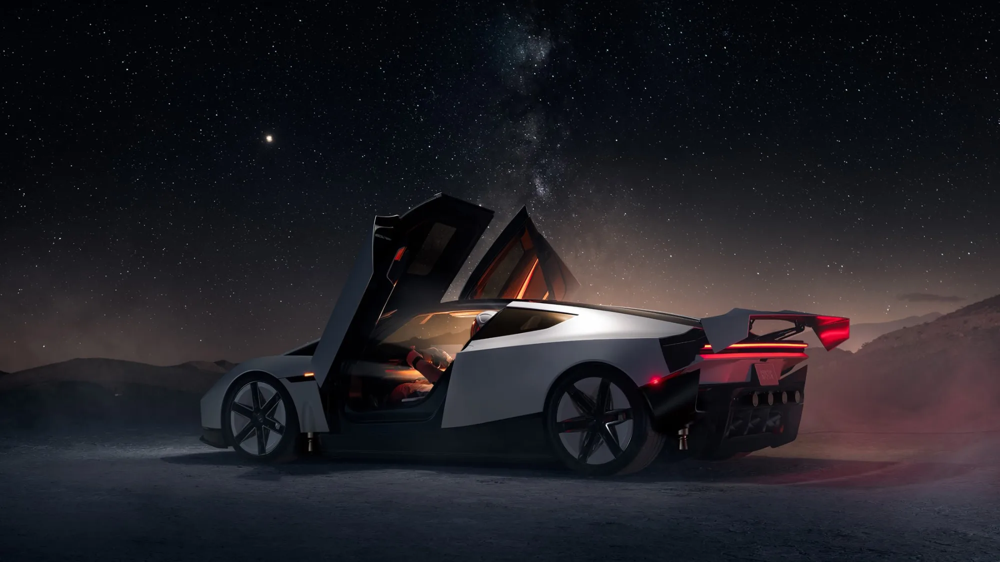

Nueve años después de su primera aparición, el **Tesla Roadster** por fin tiene versión de producción. Elon Musk lo presentó el **15 de octubre de 2026** en Texas, con una demostración que parecía más de cine que de salón del automóvil: el carro subió por una rampa invertida, giró en el aire y pasó por encima de un Cybercab, una Cybertruck, un Semi, un Model Y y un Model 3 usando propulsores de aire comprimido.

## Lo esencial

- **Presentación:** 15 de octubre de 2026, en Texas.
- **Versiones:** Performance, Thrust y Rocket.
- **Autonomía anunciada:** unos 483 km (300 millas) en las tres.
- **Velocidad máxima anunciada:** más de 370 km/h.
- **0 a 100 km/h:** menos de 1 segundo en la versión Thrust, según Tesla.
- **Producción:** 2028, según Musk.
- **Precio final:** no anunciado.

## Las tres versiones

| Versión | Puestos | Qué la diferencia | Reserva en EE. UU. |
|---|---|---|---|
| Performance | 2 | Aerodinámica activa y sistema de succión que pega el carro al piso | 50.000 dólares |
| Thrust | 2 | Agrega propulsores de gas frío en la parte trasera | 250.000 dólares |
| Rocket | 1 | Diez propulsores alrededor del carro que permiten levantarlo del suelo | Solo por invitación |

La versión **Rocket** no está aprobada para circular por vías públicas, y Tesla advierte que puede no estar disponible en todas las regiones. Según el vicepresidente de ingeniería, Lars Moravy, los diez propulsores del carro de demostración usan **600 litros de aire comprimido** que se pueden recargar.

*Tesla dice que el Roadster usa magnesio, titanio y fibra de carbono para bajar de peso. Foto: Tesla.*

## Lo que conviene tomar con cautela

El Roadster acumula promesas incumplidas. Se presentó en 2017 con reservas de 50.000 dólares, y desde entonces se aplazó en 2020, 2021, 2023 y 2024. El evento de este año estaba programado para el 1 de octubre y se movió por el clima. La fecha de **2028** para la producción también es una promesa.

Hay además preguntas sin responder sobre la seguridad. Tesla dijo que llenó “cada espacio útil” del carro con tanques de alta presión, y el propio Musk afirmó que la seguridad **“no es el objetivo principal”**. El youtuber Marques Brownlee, uno de los invitados, preguntó en público si se trataba de una broma.

Por eso el Roadster es, por ahora, una demostración tecnológica con fecha de producción a dos años: las cifras de aceleración y vuelo son de Tesla y nadie las ha medido de forma independiente.

## ¿Llega a Colombia?

La página colombiana de Tesla ya muestra el Roadster, pero solo con un botón para recibir información. A diferencia de Estados Unidos y Europa, **no abre reservas en Colombia**. Medios locales calcularon que, con las reservas en euros, la versión Performance equivaldría a unos 178 millones de pesos y la Thrust a unos 892 millones, pero esas cifras son solo el valor de la reserva convertido, no un precio de venta, y no incluyen aranceles ni impuestos.

## Preguntas frecuentes

### ¿Cuándo sale el nuevo Tesla Roadster?

Musk dijo que la producción empezará en 2028.

### ¿Cuánto cuesta?

Tesla no ha dado un precio final. Para reservarlo en Estados Unidos pide 50.000 dólares en la versión Performance y 250.000 en la Thrust.

### ¿De verdad vuela?

La versión Rocket usa propulsores para levantarse y saltar obstáculos en una demostración controlada. No está aprobada para la vía pública.

### ¿Se puede reservar en Colombia?

No por ahora. La página de Tesla Colombia solo permite registrarse para recibir información.

Mientras llega, compare los Tesla que sí se venden en el país en el [comparador de Mejor Eléctrico](/es/comparador/?a=tesla-model-y-rwd-2026-eu&b=tesla-model-3-rwd-2026-eu).

---

**Fuentes:** [TechCrunch: presentación del Roadster](https://techcrunch.com/2026/10/15/tesla-reveals-spacex-powered-roadster-that-flies-and-falls-with-style/) · [The EV Report: versiones y reservas](https://theevreport.com/tesla-roadster-unveil-spacex-cold-gas-thrusters) · [Tesla Colombia: página del Roadster](https://www.tesla.com/es_co/roadster) · [Semana: precio estimado en Colombia](https://www.semana.com/vehiculos/articulo/cuanto-costaria-en-colombia-el-tesla-roadster-el-vehiculo-electrico-con-la-capacidad-de-volar/202626/)
