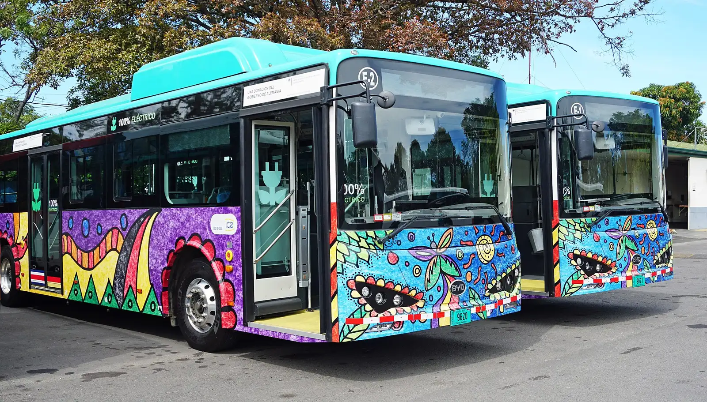

Los dos países que más rápido se electrificaron en Latinoamérica no son los grandes mercados. Son **Uruguay** y **Costa Rica**, que según la Organización Latinoamericana y Caribeña de Energía (Olade) lideran la región en carros eléctricos por habitante. Los dos usaron incentivos tributarios para arrancar, pero en 2026 sus caminos van en direcciones opuestas.

## Uruguay: los eléctricos ya venden más que la gasolina

En **mayo de 2026**, Uruguay vendió **2.671 carros eléctricos** y **2.274 de gasolina**. Fue la primera vez que los eléctricos superaron a los nafteros, como les dicen allá: se quedaron con el **43 % de las ventas** de livianos, frente al 37 % de la gasolina, el 15 % de los híbridos y el 5 % del diésel.

El salto venía de antes. En 2025, Uruguay vendió **14.443 eléctricos**, cerca del 20 % de los 71.442 vehículos nuevos del año, un 146,7 % más que en 2024. En enero de 2026 ya eran el 21,1 % del mercado.

| Uruguay | Cifra |
|---|---|
| Eléctricos vendidos en 2025 | 14.443 |
| Participación en 2025 | Cerca del 20 % |
| Eléctricos vendidos en mayo de 2026 | 2.671 |
| Participación en mayo de 2026 | 43 % |

Fuentes: Bloomberg Línea con datos de la Asociación del Comercio Automotor del Uruguay, y Ámbito.

### Qué explica el caso uruguayo

Los incentivos son concretos y se suman:

- **Impuesto anual al vehículo más bajo:** en 2026, la patente de un eléctrico nuevo es del 3 % de su valor, frente al 5 % de uno de combustión.
- **Seguro más barato:** el Banco de Seguros del Estado da un 15 % de descuento a los carros eléctricos.
- **Crédito verde:** Santander, HSBC, Itaú y BBVA ofrecen créditos especiales.
- **Energía:** la empresa estatal UTE tiene un plan de movilidad eléctrica con descuentos para conectar o ampliar la potencia en casa y tarifas reducidas en ciertas horas.

*Buses eléctricos en Costa Rica, el otro país que lidera la región en eléctricos por habitante. Foto: Mariordo (Mario Roberto Durán Ortiz), CC BY-SA 4.0, vía Wikimedia Commons.*

## Costa Rica: el pionero que retira beneficios

Costa Rica aprobó en 2018 la Ley 9518 de incentivos al transporte eléctrico, que eximió a los eléctricos de buena parte de los impuestos de importación, venta y propiedad. Fue una de las leyes más generosas de la región. Desde el **13 de junio de 2025**, esos beneficios empezaron a reducirse:

| Impuesto | Antes | Desde junio de 2025 |
|---|---|---|
| Selectivo de consumo (30 % del valor) | Exento | Se paga el 25 %: 7,5 % efectivo |
| Arancel (1 % del valor CIF) | Exento | Se paga el 25 %: 0,25 % efectivo |
| IVA | Reducido | 3 % en 2025, subiendo hasta el 13 % general |
| Marchamo, el impuesto anual | Exento | Exención del 40 % en 2025, bajando 20 puntos por año |

En junio de 2028, la exención de los impuestos de importación baja al 50 %. La asociación del sector, Asomove, proyectaba cerca de 35.000 eléctricos en circulación en 2026. En 2025, Costa Rica vendió 14.058 carros electrificados, prácticamente lo mismo que en 2024 (−0,4 %), mientras el resto de la región crecía a doble y triple dígito.

## La lección para la región

Los dos casos muestran que el precio de compra es la palanca más fuerte. Uruguay mantuvo y amplió beneficios y vio cómo los eléctricos pasaban a la gasolina. Costa Rica empezó a retirarlos y sus ventas de electrificados se estancaron en 2025. No hay datos suficientes para atribuir todo el estancamiento a la reducción de beneficios, pero la coincidencia es difícil de ignorar.

Para Colombia, que hoy tiene IVA del 5 % y arancel cero para los eléctricos, la discusión es la misma: cuánto tiempo sostener los incentivos y cómo retirarlos sin frenar el mercado. Lo explicamos en [beneficios de comprar un eléctrico](/es/notas/beneficios-tributarios-carro-electrico-2026/).

## Preguntas frecuentes

### ¿Qué país de Latinoamérica tiene más carros eléctricos por habitante?

Uruguay y Costa Rica lideran la región por habitante, según Olade.

### ¿Es cierto que en Uruguay se venden más eléctricos que carros de gasolina?

Sí, en mayo de 2026: 2.671 eléctricos frente a 2.274 de gasolina.

### ¿Costa Rica quitó los beneficios a los carros eléctricos?

Los está reduciendo de forma gradual desde junio de 2025, con nuevos recortes previstos hasta 2028.

---

**Fuentes:** [Ámbito: los eléctricos superan por primera vez a los nafteros en Uruguay](https://www.ambito.com/uruguay/las-ventas-autos-electricos-marcaron-un-record-y-superaron-primera-vez-los-nafteros-n6286872) · [Bloomberg Línea: ventas de eléctricos en Uruguay](https://www.bloomberglinea.com/latinoamerica/uruguay/ventas-de-vehiculos-electricos-se-cuadruplican-en-uruguay-que-explica-el-auge/) · [Delfino: reducción de exoneraciones en Costa Rica](https://delfino.cr/2025/06/a-partir-del-13-de-junio-se-aplicara-reduccion-en-exoneraciones-fiscales-para-vehiculos-electricos) · [La República de Costa Rica: los beneficios empiezan a desaparecer](https://www.larepublica.net/noticia/beneficios-fiscales-para-vehiculos-electricos-empiezan-a-desaparecer) · [Bloomberg Línea: ventas de electrificados por país en 2025](https://www.bloomberglinea.com/2026/02/11/los-paises-lideres-en-ventas-de-autos-electricos-y-estaciones-de-carga-en-latinoamerica/) · [Forbes Perú: datos de Olade](https://forbes.pe/negocios/2026-09-22/latinoamerica-supera-el-millon-de-vehiculos-electricos-con-mas-de-la-mitad-en-brasil/)
