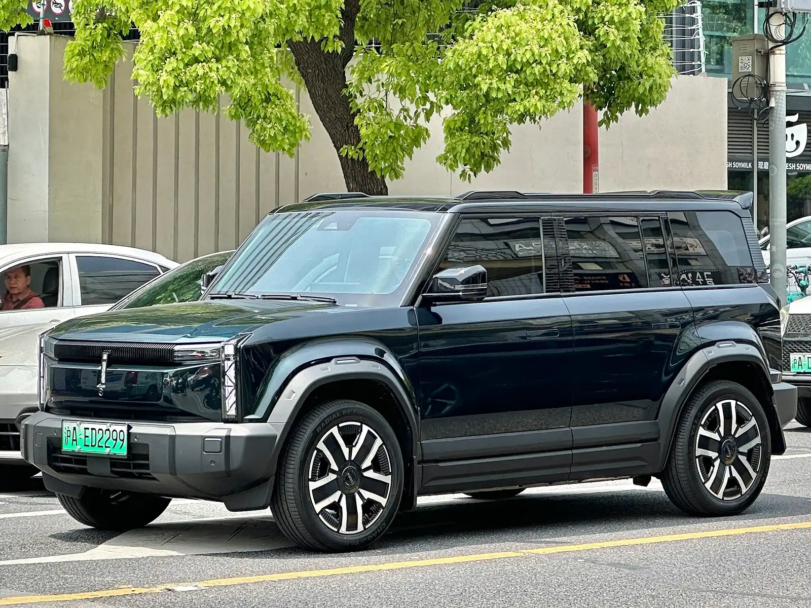

**V2L** significa *vehicle to load*, del vehículo a la carga. Es la función que permite usar la batería de un carro eléctrico para alimentar aparatos externos, como una planta eléctrica silenciosa. Algunos carros tienen un enchufe dentro de la cabina o en el baúl; otros usan un adaptador que se conecta al puerto de carga y termina en un tomacorriente normal.

## Cuánta potencia da

Las potencias máximas que publican los fabricantes van de **2,2 a 3,6 kW**, según la base de datos de eléctricos de Nueva Zelanda EVDB. Como referencia, una nevera doméstica gasta en promedio alrededor de 1 kWh al día, así que una batería de 50 o 60 kWh podría mantenerla funcionando muchos días si no se usa para nada más.

| Potencia V2L | Ejemplos de modelos |
|---|---|
| 2,2 kW | BYD Atto 3, MG4 |
| 3 kW | BYD Seal |
| 3,2 kW | Kia EV5, Polestar 4 |
| 3,3 kW | BYD Dolphin, BYD Sealion 7, Geely EX5, Leapmotor C10 |
| 3,6 kW | Hyundai Ioniq 5 e Ioniq 6, Kia EV3, EV6 y EV9 |

Potencias de las versiones vendidas en Nueva Zelanda. En otros mercados pueden cambiar, y en algunos modelos el V2L depende de la versión o del accesorio.

En Colombia, las fichas publicadas confirman V2L en el **BYD Seagull**, el **Chery iCar 03** y la **Geely EX5 Max**, entre otros.

*El Chery iCar 03 es uno de los carros con V2L confirmado en las fichas colombianas. Foto: JustAnotherCarDesigner, CC0, vía Wikimedia Commons.*

## Qué se puede conectar

Con 3 kW alcanza para la mayoría de aparatos de una casa, uno o dos a la vez: una nevera, un computador, luces, un televisor, una olla arrocera o herramientas eléctricas pequeñas. Los aparatos de alto consumo, como una ducha eléctrica, un horno o un calentador, pueden pasar el límite y conviene usarlos solo por ratos cortos, o no usarlos.

Sirve en un corte de luz, en un paseo con nevera portátil y luces, o para trabajar al aire libre con herramientas. Algunos carros permiten además cargar otro carro eléctrico, muy despacio, en una emergencia.

## Lo que hay que tener en cuenta

**La batería del carro se descarga.** Muchos carros permiten fijar un límite, por ejemplo que el V2L se apague al llegar al 20 %, para no quedarse sin autonomía. Configúrelo antes de usarlo.

**No es una conexión a la red de la casa.** El V2L alimenta aparatos enchufados directamente al carro o a una extensión. Conectar el carro a la instalación eléctrica de la casa es otra tecnología, llamada V2H, que exige equipos especiales y un electricista. Hacerlo sin ellos es peligroso para el carro, la casa y los técnicos de la empresa de energía.

**Use extensiones de buena calidad** y del calibre adecuado para la potencia que va a conectar.

> En países con cortes de luz frecuentes o zonas rurales sin red estable, el V2L puede ser un argumento de compra tan importante como la autonomía.

## Preguntas frecuentes

### ¿Qué es el V2L en un carro eléctrico?

Una función que permite sacar energía de la batería del carro para alimentar aparatos externos.

### ¿Cuánta potencia da el V2L?

Entre 2,2 y 3,6 kW en los modelos más comunes, según el fabricante.

### ¿Se puede conectar el carro a la casa con V2L?

No directamente. Para alimentar la instalación de la casa se necesita un sistema V2H, con equipos especiales y un electricista certificado.

---

**Fuentes:** [EVDB Nueva Zelanda: guía y potencias de V2L](https://evdb.nz/v2l) · [El Carro Colombiano: BYD Seagull con V2L](https://www.elcarrocolombiano.com/recomendados/byd-seagull-nuevo-precio-colombia-byd-fest-2026/) · [El Carro Colombiano: Chery iCar 03](https://www.elcarrocolombiano.com/resenas/chery-icar-03-el-4x4-electrico-definitivo-candidato-a-el-carro-del-ano-2025-en-colombia/) · [Geely Colombia: ficha técnica de la EX5](https://geely.com.co/wp-content/uploads/2026/03/EX5_Bajav4.pdf)
