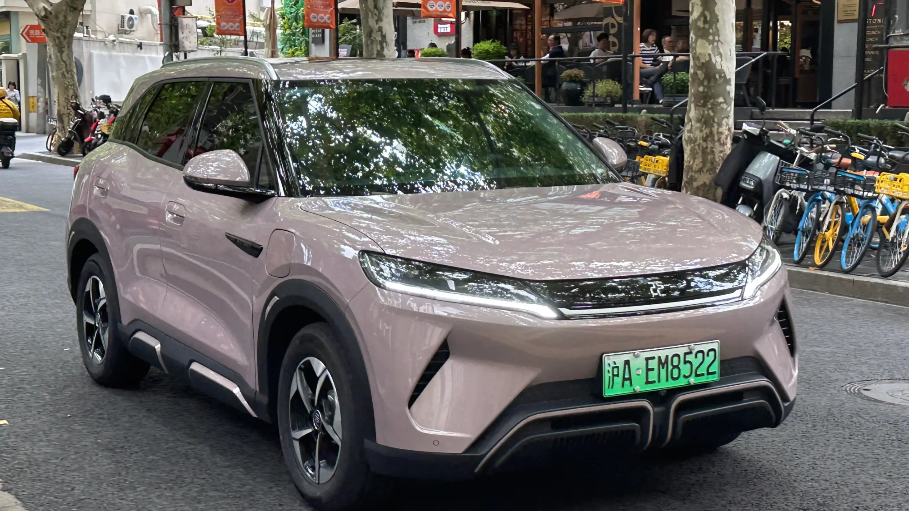

El mercado de eléctricos en Colombia sigue rompiendo récords. En **septiembre de 2026 se matricularon 5.895 carros eléctricos**, un crecimiento de **217,3 %** frente a los 1.858 de septiembre de 2025. Con eso, los eléctricos ya representan el **17,4 % de todos los carros nuevos** que se venden en el país, según el informe de Fenalco y la Andi con datos del RUNT.

## Las cifras del mes y del año

| Indicador | Septiembre de 2026 | Enero a septiembre de 2026 |
|---|---|---|
| Eléctricos matriculados | 5.895 | 39.784 |
| Crecimiento anual | 217,3 % | 221,7 % |
| SUV eléctricos | 4.883 | 31.210 |

El acumulado del año ya es **más del triple** de los 12.366 eléctricos que se habían matriculado entre enero y septiembre de 2025. Septiembre fue además el mejor mes del año, por encima de julio (4.870) y agosto (4.542).

## Los SUV mandan

Ocho de cada diez eléctricos vendidos en 2026 son SUV. El dato confirma que el colombiano no está buscando un carro urbano pequeño, sino un reemplazo eléctrico para la camioneta familiar.

## Los modelos más vendidos en septiembre

| Puesto | Modelo | Matrículas | Participación |
|---|---|---|---|
| 1 | Tesla Model Y | 2.220 | 37,7 % |
| 2 | Chery E5 | 483 | 8,2 % |
| 3 | BYD Yuan Up | 409 | 6,9 % |
| 4 | MG S5 | 324 | 5,5 % |
| 5 | Tesla Model 3 | 215 | 3,6 % |

La sorpresa del mes es la **Chery E5**, que llegó al mercado en mayo y ya es el segundo eléctrico más vendido. En el acumulado del año, el top lo completan el Tesla Model Y (14.381), el BYD Yuan Up (3.908), el Tesla Model 3 (2.161), el BYD Seagull (1.909) y el Chery Icar (1.882).

*El BYD Yuan Up, tercero en septiembre con 409 unidades y segundo en el acumulado del año. Foto: JustAnotherCarDesigner, dominio público (CC0), vía Wikimedia Commons.*

## Dónde se venden

| Ciudad | Septiembre | En el año |
|---|---|---|
| Bogotá | 2.964 | 20.707 |
| Medellín | 1.472 | 10.380 |
| Cali | 538 | 3.246 |

Bogotá suma más de la mitad de las matrículas del año. No es casualidad: allí se combinan el mayor número de electrolineras, el descuento del 60 % en el impuesto vehicular y la exención del pico y placa en una ciudad donde el pico y placa solidario cuesta $70.294 al día.

## Lo que hay detrás del salto

- **Precios más bajos.** La llegada de Tesla, con precios de entrada cercanos a $115 millones, obligó a otras marcas a ajustar. Lo contamos en nuestra nota sobre [la guerra de precios](/es/notas/guerra-de-precios-carros-electricos-efecto-tesla/).
- **Créditos más baratos.** Las tasas para eléctricos van de 12 % a 16,6 % efectivo anual, frente a 23,5 % a 26,5 % para carros de combustión.
- **Beneficios tributarios** confirmados por la DIAN para personas naturales en 2026.

El cuello de botella es la infraestructura: el país tiene unos 520 puntos de carga públicos, una relación que analizamos en [esta nota](/es/notas/electrolineras-colombia-deficit-puntos-de-carga-2026/).

## Preguntas frecuentes

### ¿Cuál es el carro eléctrico más vendido de Colombia en 2026?

El Tesla Model Y, con 14.381 unidades entre enero y septiembre. En junio fue, además, el carro más vendido del país entre todas las tecnologías.

### ¿Qué marca vende más eléctricos?

Tesla, con 41,6 % del acumulado del año, seguida por BYD con 20,7 % y Chery con 6,3 %.

### ¿Cuántos eléctricos hay en Colombia?

El RUNT registraba 77.215 vehículos eléctricos a mayo de 2026.

Compare los más vendidos en el [comparador de Garash](/es/comparador/).

---

**Fuentes:** [Portafolio: eléctricos más vendidos en septiembre de 2026](https://www.portafolio.co/negocios/vehiculo/tesla-domina-los-electricos-mas-vendidos-en-colombia-concentro-41-3-de-las-matriculas-durante-septiembre-504120) · [Portafolio: tasas de crédito para eléctricos](https://www.portafolio.co/negocios/vehiculo/carros-electricos-ganan-terreno-en-colombia-por-tasas-bajas-iva-reducido-y-alivios-tributarios-493822) · [La República: puntos de carga en Colombia](https://www.larepublica.co/economia/solo-hay-un-punto-de-carga-por-cada-337-carros-electricos-en-total-hay-229-electrolineras-4398785) · [Infobae: pico y placa solidario 2026](https://www.infobae.com/colombia/2026/05/07/conductores-podran-quedar-exentos-del-pico-y-placa-en-bogota-sin-pagar-asi-funciona-el-beneficio-para-2026/)
