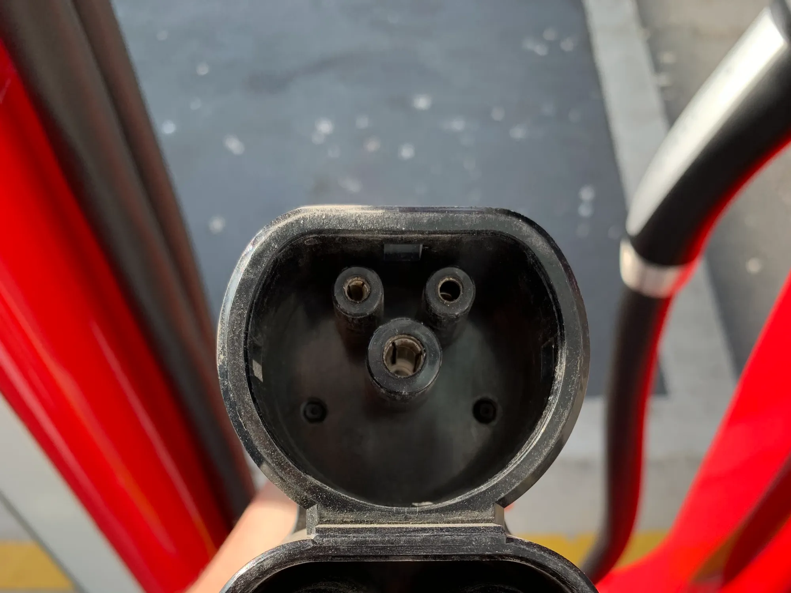

Un viaje largo en carro eléctrico se planea al revés que uno en carro de gasolina. Con gasolina, se sale y se tanquea donde haya una estación, porque hay en casi todas partes. Con un eléctrico, la ruta se arma alrededor de los cargadores rápidos, que en Latinoamérica todavía están concentrados en las ciudades y en algunos corredores. Con la planeación correcta, un viaje de 300 o 400 km es perfectamente posible; sin ella, puede terminar en una espera de horas.

## 1. Calcule con la autonomía real, no con la de la ficha

La autonomía de la ficha, sobre todo si es NEDC o CLTC, es más alta que la que el carro logra en carretera. A 100 o 110 km/h, con aire acondicionado y subidas, hay que esperar bastante menos. Una regla prudente es planear las paradas para llegar a cada cargador con un 15 % o 20 % de batería de margen, por si el cargador está ocupado o fuera de servicio. Las diferencias entre ciclos están explicadas en [esta nota](/es/notas/autonomia-electricos-cltc-nedc-wltp-como-leerla/).

En Colombia, la montaña pesa más que la distancia. Una subida larga gasta mucho más que un tramo plano de la misma longitud, aunque la bajada devuelve una parte gracias al [freno regenerativo](/es/notas/freno-regenerativo-como-funciona/).

## 2. Use las apps de carga

Las aplicaciones muestran en un mapa dónde hay cargadores, qué conector y qué potencia tiene cada uno, si están libres en ese momento y qué opinan otros conductores. En Colombia, Blu Radio menciona entre las gratuitas las de **Enel X**, **Evsy** y **Electromaps**, y los operadores grandes tienen la suya, como la de Terpel para su red Voltex. Las reseñas recientes son clave: avisan si un cargador lleva días dañado.

Antes de salir, filtre por el conector de su carro. No todas las estaciones sirven para todos los eléctricos, y un cargador con conector distinto no le sirve sin adaptador. La guía de conectores está [aquí](/es/notas/conectores-carga-electricos-colombia-tipo-1-tipo-2-ccs-gbt/).

*El conector CCS de un supercargador de Tesla. Antes de salir, filtre en la app por el conector de su carro. Foto: Panagiotis Katoikos, CC BY-SA 4.0, recortada, vía Wikimedia Commons.*

## 3. Prefiera cargadores rápidos y paradas cortas

Un cargador rápido de corriente continua puede llevar la batería al 80 % en unos 30 minutos; uno semirrápido de corriente alterna puede tardar más de una hora. Por eso, en ruta conviene parar en cargadores rápidos y cargar hasta el 80 %, no hasta el 100 %: el último tramo de la carga es mucho más lento y alarga la parada sin sumar tantos kilómetros. Si la parada coincide con el almuerzo, la espera casi no se siente. Y siempre conviene tener identificado un segundo cargador dentro del radio de autonomía.

## 4. Revise qué hay en su ruta

Los corredores con más cargadores en Colombia, según Blu Radio, son Bogotá a Villavicencio, Medellín a Cartagena y la Troncal del Caribe, y la expansión se concentra alrededor de Bogotá, Medellín, Cali y Bucaramanga. En 2023, gremios del sector presentaron la Ruta Eléctrica Andina, que plantea cargadores rápidos o semirrápidos cada 200 km entre Cartagena e Ipiales, con conexión a Ecuador y Perú.

Tesla tiene supercargadores en Bogotá y Medellín, en los centros comerciales Andino y Unicentro, pero no en las carreteras, así que un Tesla en ruta depende de las redes de otros operadores.

## 5. Tenga un plan B

Lleve el cargador portátil del carro: en una emergencia, un tomacorriente doméstico sirve para recuperar algunos kilómetros, aunque muy despacio. Y antes de salir, cargue al 100 % en casa, donde la energía es más barata.

> El error más común no es quedarse sin batería en la vía, sino llegar a un cargador que está ocupado o dañado sin tener otro cerca. Planee siempre la parada siguiente.

## Preguntas frecuentes

### ¿Se puede viajar de Bogotá a Medellín en un carro eléctrico?

Sí, con planeación. Revise en una app los cargadores rápidos de la ruta y calcule las paradas con margen, porque la topografía aumenta el consumo.

### ¿Qué app sirve para encontrar electrolineras?

En Colombia, las de Enel X, Evsy y Electromaps, además de las de los operadores de carga.

### ¿Hasta qué porcentaje conviene cargar en ruta?

Hasta el 80 % en cargadores rápidos. Desde ahí la carga se vuelve mucho más lenta.

---

**Fuentes:** [Blu Radio: cómo planear un viaje en carro eléctrico en Colombia](https://www.bluradio.com/motor/como-planear-viaje-carro-electrico-colombia-so35) · [Portafolio: la Ruta Eléctrica Andina](https://www.portafolio.co/sostenibilidad/detalles-de-la-ruta-electrica-andina-que-inauguro-latinoamerica-en-colombia-588814) · [Semana: supercargadores de Tesla en Colombia](https://www.semana.com/vehiculos/articulo/mapa-lista-de-ciudades-con-supercargadores-de-tesla-en-colombia-y-cuanto-cuesta-usarlos/202633/)
