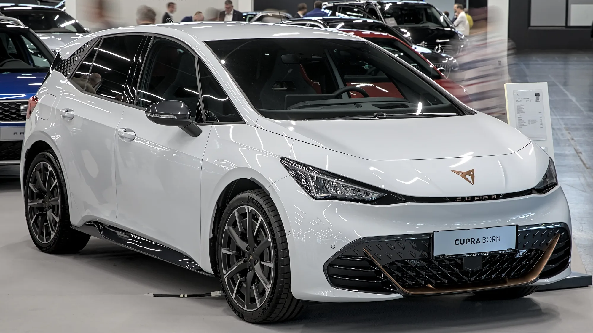

El **Grupo Volkswagen** llamó a revisión carros eléctricos de la familia **ID** de Volkswagen y de la marca **Cupra** por un defecto en la **batería** que, en el peor de los casos, podría causar un incendio. La información la dio a conocer el 16 de octubre de 2026 la cadena pública alemana NDR, y la recogieron agencias como EFE.

## Lo esencial

- **Marcas:** Volkswagen (familia ID) y Cupra.
- **Años de fabricación:** 2023 y 2024.
- **Defecto:** una falla en la producción de un proveedor de componentes de la batería.
- **Riesgo:** incendio, en el peor de los casos. La marca lo describe como una posibilidad extrema.
- **Unidades afectadas:** no se han publicado.
- **País del anuncio:** Alemania.

## Lo que se sabe y lo que no

Volkswagen dijo que se trata de una **campaña preventiva** y que el incendio sería el escenario más grave posible, no el comportamiento esperado de los carros. No ha dicho cuántos carros están incluidos, qué modelos exactos de la familia ID ni de Cupra, ni quién es el proveedor.

No es el primer problema de baterías del grupo este año. En marzo de 2026, Volkswagen ya había llamado a revisión cerca de **100.000 eléctricos** por módulos de batería potencialmente defectuosos. Y por separado, el grupo tiene en curso un llamado a revisión de más de **4,5 millones** de carros de Volkswagen, Audi y Skoda por un problema en la dirección, que no tiene relación con las baterías.

*El Cupra Born, el eléctrico compacto de Cupra, comparte plataforma con el Volkswagen ID.3. Foto: Alexander-93, CC BY-SA 4.0, recortada, vía Wikimedia Commons.*

## ¿Afecta a Colombia?

El llamado se anunció en Alemania y por ahora no hay un anuncio para Colombia. Volkswagen vende eléctricos de la familia ID en algunos mercados de América Latina, así que si usted tiene un ID o un Cupra eléctrico fabricado en 2023 o 2024, lo prudente es preguntar en el concesionario si su número de identificación (VIN) está incluido.

En Colombia, los llamados a revisión se pueden consultar en la página de la **Superintendencia de Industria y Comercio**, que publica las campañas que reportan las marcas.

> Un llamado a revisión no significa que el carro sea peligroso hoy. Significa que la marca encontró un defecto y lo corrige gratis. El riesgo está en no atenderlo.

## Qué hacer si tiene un eléctrico de Volkswagen o Cupra

1. Busque el VIN en la tarjeta de propiedad o en la base del parabrisas.
2. Consulte con el concesionario o en la página de llamados a revisión de la SIC.
3. Si su carro está incluido, agende la revisión y pregunte si mientras tanto hay alguna recomendación sobre cómo y dónde cargarlo.

## Preguntas frecuentes

### ¿Qué carros incluye el llamado a revisión?

Eléctricos de la familia ID de Volkswagen y de Cupra fabricados en 2023 y 2024. La marca no ha publicado la lista exacta.

### ¿Cuál es el riesgo?

Un defecto de batería que, en el peor caso, podría causar un incendio.

### ¿Aplica en Colombia?

No hay anuncio para Colombia por ahora. Consulte con el concesionario usando el VIN de su carro.

Compare eléctricos y sus garantías de batería en el [comparador de Mejor Eléctrico](/es/comparador/).

---

**Fuentes:** [Infobae y EFE: llamado a revisión de Volkswagen y Cupra](https://www.infobae.com/america/agencias/2026/10/16/grupo-volkswagen-llama-a-revision-a-modelos-id-y-de-marca-cupra-por-problemas-en-baterias/) · [El Debate: riesgo de incendio](https://www.eldebate.com/motor/20261016/grupo-volkswagen-llama-revision-coches-electricos-grave-fallo-riesgo-incendio_470614.html) · [Electrek: llamado a revisión de marzo de 2026](https://electrek.co/2026/03/24/volkswagen-recalling-100000-evs-over-potential-battery-issues/)
