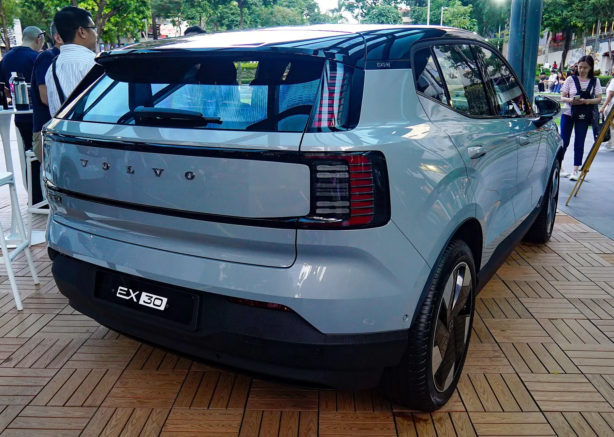

El **Volvo EX30** es el SUV eléctrico más pequeño de la marca: **4.233 mm de largo, 1.837 mm de ancho y 1.549 mm de alto**, con una distancia entre ejes de **2.650 mm**. Es 21 centímetros más corto que una Volvo XC40. Su baúl trasero tiene **318 litros**, una cifra justa para su tamaño, y adelante, donde otros eléctricos tienen un segundo baúl útil, solo hay un compartimiento de **7 litros**.

## Medidas del Volvo EX30

| Medida | EX30 | EX30 Cross Country |
|---|---|---|
| Largo | 4.233 mm | 4.233 mm |
| Ancho | 1.837 mm | 1.837 mm |
| Alto | 1.549 mm | 1.573 mm |
| Distancia entre ejes | 2.650 mm | 2.650 mm |
| Baúl trasero | 318 L | 318 L |
| Baúl con la segunda fila abatida | 904 L | Sin dato en la fuente |
| Compartimiento delantero | 7 L | 7 L |
| Puestos | 5 | 5 |

Medidas de la base de datos EV Database para los modelos 2026; la capacidad con la segunda fila abatida es de Motor1. Otras fuentes publican un alto de 1.555 mm para versiones anteriores.

El **Cross Country** es la versión aventurera: tiene la carrocería 2,4 cm más alta, protecciones plásticas y la misma huella sobre el piso. No es un carro más grande, así que el espacio interior y el baúl no cambian.

## Cómo se compara en tamaño

| SUV eléctrico | Largo | Baúl trasero |
|---|---|---|
| Volvo EX30 | 4,23 m | 318 L |
| Kia EV3 | 4,30 m | 460 L |
| BYD Atto 2 (Yuan Up en Colombia) | 4,31 m | 400 o 450 L, según la batería |
| Geely EX5 | 4,61 m | 461 L |
| Tesla Model Y | 4,79 m | 822 a 835 L, más 116 L adelante |

El EX30 es el más corto de la tabla y el de menor baúl. El Kia EV3, con apenas 7 cm más de largo, ofrece 142 litros más atrás, y el Atto 2, con 8 cm más, entre 82 y 132 litros más. Los 38 centímetros de diferencia en largo frente a la Geely EX5 se traducen en 143 litros menos de carga.

*El baúl trasero del EX30 tiene 318 litros, la cifra que más se queda corta frente a sus rivales. Foto: Ethan Llamas, CC BY-SA 4.0, vía Wikimedia Commons.*

## Qué significan las medidas en el uso diario

Con 4,23 metros, el EX30 cabe en casi cualquier parqueadero de conjunto o de centro comercial, incluidos los cupos estrechos de las ciudades colombianas. En el baúl de 318 litros caben las compras del mercado o dos maletas de cabina, pero no el equipaje de cuatro personas para una semana. Para una familia que viaja seguido, la diferencia con un EV3 o un EX5 se nota.

## El EX30 en Colombia

Volvo lanzó el EX30 en Colombia en junio de 2024 en las versiones Core, Plus y Ultra, con baterías de 51 o 69 kWh y precios de lanzamiento entre $179,99 y $259,99 millones. Tiene cinco estrellas en Euro NCAP, con 88 % en protección de adultos, como contamos en [su nota de seguridad](/es/notas/volvo-ex30-euro-ncap-5-estrellas/).

> Si el baúl es prioridad, lleve sus maletas a la prueba de manejo y mida. Los 318 litros del EX30 son la cifra que más se queda corta frente a sus rivales.

## Preguntas frecuentes

### ¿Cuánto mide el Volvo EX30?

4.233 mm de largo, 1.837 mm de ancho y 1.549 mm de alto, con 2.650 mm entre ejes.

### ¿Cuántos litros tiene el baúl del Volvo EX30?

318 litros con los cinco puestos y 904 con la segunda fila abatida, más 7 litros en el compartimiento delantero.

### ¿El EX30 Cross Country es más grande?

No en largo ni en ancho. Es 2,4 cm más alto por la suspensión elevada, y el baúl es igual.

---

**Fuentes:** [EV Database: Volvo EX30 P5 Long Range](https://ev-database.org/car/3480/Volvo-EX30-P5-Long-Range) · [EV Database: Volvo EX30 Cross Country](https://ev-database.org/car/3482/Volvo-EX30-Cross-Country-P5-Long-Range) · [Motor1: dimensiones y baúl del Volvo EX30](https://www.motor1.com/news/712706/volvo-ex30-dimensions-boot-space-analysis/) · [Valora Analitik: el Volvo EX30 en Colombia](https://www.valoraanalitik.com/volvo-ex-30-precios-caracteristicas-colombia-cuanto-vale/) · [EV Database: BYD Atto 2](https://ev-database.org/car/3268/BYD-ATTO-2-648-kWh) · [EV Database: Tesla Model Y](https://ev-database.org/car/3741/Tesla-Model-Y-RWD) · [EV Database: Kia EV3](https://ev-database.org/car/3638/Kia-EV3-Long-Range) · [Euro NCAP: ficha de la prueba del Volvo EX30](https://cdn.euroncap.com/media/85377/euroncap-2024-volvo-ex30-datasheet.pdf)
