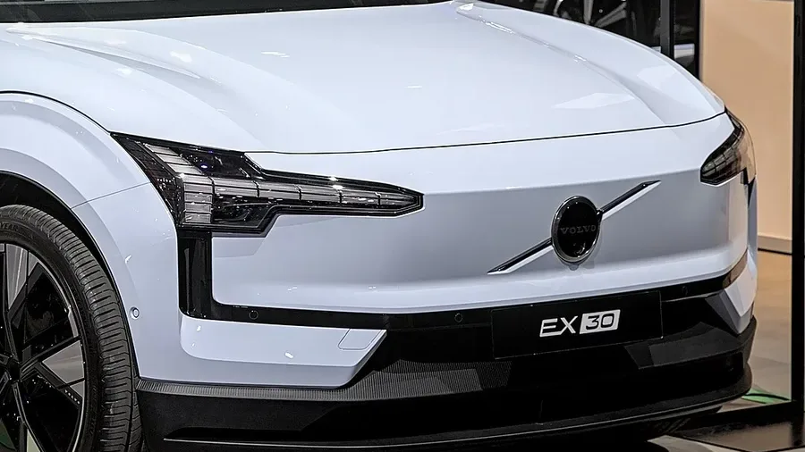

Volvo construyó su marca alrededor de la seguridad, así que el resultado del **EX30** en **Euro NCAP** tenía que estar a la altura. Lo está: **cinco estrellas** y **88 % en protección de adultos**. Pero la ficha de la prueba muestra dos puntos que no son perfectos, y uno de ellos sorprende en un Volvo.

## Lo esencial

- **Calificación:** 5 estrellas, publicada en diciembre de 2024.
- **Versión evaluada:** EX30 Plus, un motor, batería de mayor autonomía, 1.775 kg.
- **Protección de adultos:** 88 %.
- **Protección de niños:** 85 %.
- **Usuarios vulnerables:** 79 %.
- **Asistencias a la conducción:** 80 %.

## Los choques

| Prueba | Resultado |
|---|---|
| Frontal contra barrera móvil | Habitáculo estable y buena protección de rodillas y piernas. Perdió puntos porque Volvo no demostró la misma protección para ocupantes de otras tallas |
| Frontal contra muro | Pecho del pasajero trasero marginal, lo demás bueno |
| Lateral contra otro vehículo | Puntaje máximo |
| Lateral contra poste | Pecho débil, lo demás bueno |
| Latigazo cervical | Bueno adelante y atrás |

Además, Euro NCAP lo calificó como un carro **poco agresivo con el otro vehículo** en un choque frontal, algo relevante porque el EX30 pesa casi 1,8 toneladas.

*Las luces delanteras en forma de martillo son la firma de los eléctricos de Volvo. Foto: Alexander-93, CC BY-SA 4.0, recortada, vía Wikimedia Commons.*

## Asistencias: fuerte en frenado, flojo en el monitor

El frenado autónomo funcionó bien frente a otros carros (7,8 de 9), ciclistas (7,1 de 8) y motociclistas (5,9 de 6). Con peatones fue adecuado (5,2 de 9). El mantenimiento de carril sacó la nota completa: 3 de 3.

El punto que sorprende es el **monitor del conductor**. El EX30 trae de serie una cámara que sigue los ojos del conductor para detectar cansancio y distracción, pero sacó apenas **0,6 de 2**. Tampoco trae **detector de niños olvidados** en la cabina, y el sistema que avisa al abrir la puerta si viene un ciclista no viene activado por defecto, así que no sumó.

> Con 80 % en asistencias, el EX30 pasa con holgura el mínimo de 70 % para cinco estrellas. Los puntos que pierde son de sistemas de vigilancia, no de protección en el choque.

## Lo que hay que saber en Colombia

El EX30 llegó a Colombia en junio de 2024 en las versiones Core, Plus y Ultra, con baterías de 51 o 69 kWh y precios de lanzamiento entre $179,99 y $259,99 millones. La estructura es la misma en toda la gama, así que el resultado de los choques aplica a todas. Volvo anunció para el mercado colombiano el frenado autónomo, la alerta al abrir las puertas y el monitor de somnolencia y distracción con cámara infrarroja, los mismos sistemas que Euro NCAP revisó.

## Preguntas frecuentes

### ¿Cuántas estrellas tiene el Volvo EX30 en Euro NCAP?

Cinco estrellas, publicadas en diciembre de 2024.

### ¿Cuál fue su punto más débil?

El monitor del conductor, con 0,6 de 2 puntos, y la protección del pecho en el choque contra poste.

### ¿Trae detector de niños olvidados?

No. Euro NCAP anotó que no lo tiene, y por eso perdió puntos en protección de niños.

Compare el EX30 con el Kia EV3 en el [comparador de Mejor Eléctrico](/es/comparador/?a=volvo-ex30-p5-2026-eu&b=kia-ev3-long-range-2026-eu).

---

**Fuentes:** [Euro NCAP: ficha de la prueba del Volvo EX30](https://cdn.euroncap.com/media/85377/euroncap-2024-volvo-ex30-datasheet.pdf) · [Auto Industriya: cinco estrellas del EX30](https://www.autoindustriya.com/auto-industry-news/euro-ncap-volvo-scores-perfect-five-stars-with-ex30.html) · [Valora Analitik: Volvo EX30 en Colombia](https://www.valoraanalitik.com/volvo-ex-30-precios-caracteristicas-colombia-cuanto-vale/)
