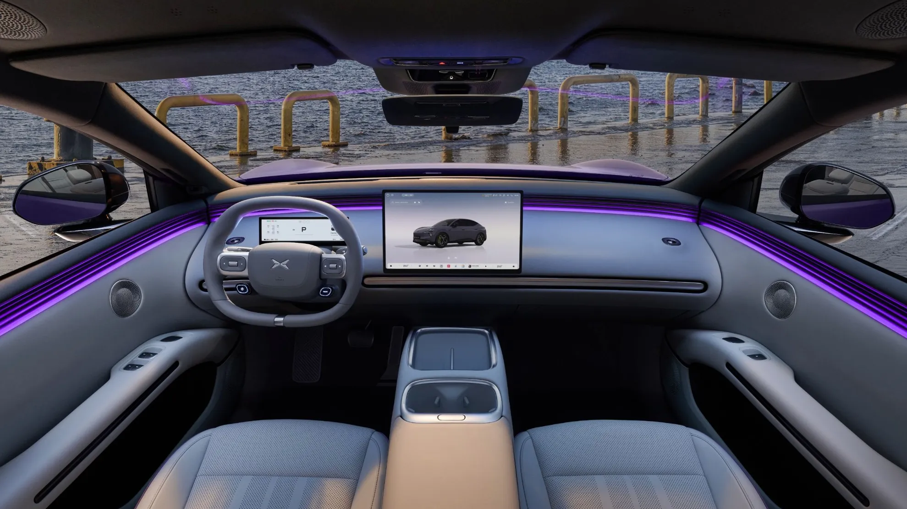
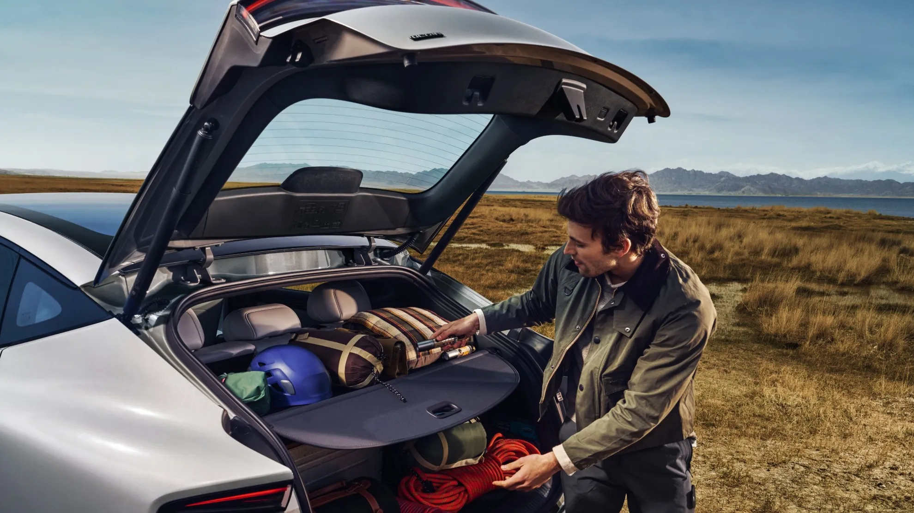
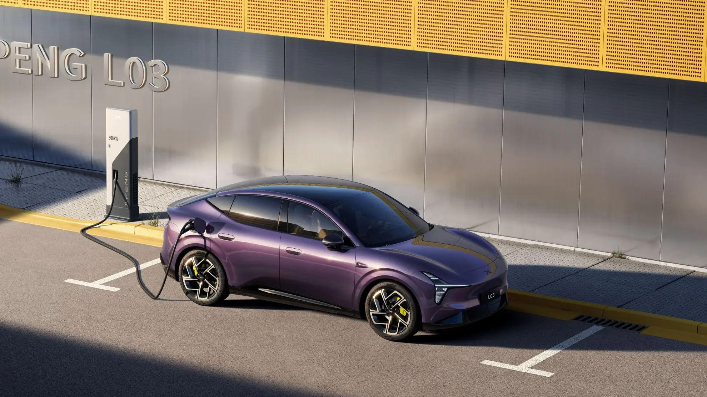

El **XPeng L03** ya se vende en Colombia, apenas unos meses después de su estreno mundial en junio de 2026. Es un **SUV coupé de 4,65 metros**, el modelo de entrada de XPeng por debajo del G6, y llega en dos versiones: una **100 % eléctrica** y otra de **rango extendido**, en la que un motor de gasolina solo genera electricidad. Ambas aparecen en la web de XPeng Colombia **desde $115.000.000**, precio sugerido al público. La marca la representa en el país **Inchcape**, que ya vende aquí la G6 y la G9.

## Lo esencial

- **Precio:** desde $115.000.000, según la web de XPeng Colombia. La página da el mismo precio para las dos versiones: conviene confirmarlo con el concesionario.
- **Versiones:** L03 Long Range Plus (eléctrica) y L03 PowerX Plus (rango extendido).
- **Autonomía:** hasta 520 km WLTP la eléctrica y hasta 1.017 km WLTP en total la de rango extendido.
- **Potencia:** 241 hp (180 kW), con tracción trasera en las dos.
- **Batería:** LFP de 71,2 kWh en la eléctrica y de 37,2 kWh en la de rango extendido.
- **Garantía:** 5 años o 120.000 km para el carro y 8 años o 160.000 km para batería, motor y electrónica de potencia.

## Las dos versiones

| | L03 Long Range Plus | L03 PowerX Plus |
|---|---|---|
| Motorización | Eléctrica | Rango extendido (motor 1.5 de gasolina como generador) |
| Batería | 71,2 kWh LFP | 37,2 kWh LFP |
| Autonomía WLTP | Hasta 520 km | Unos 215 a 235 km eléctricos; 1.017 km en total |
| Potencia | 241 hp (180 kW) | 241 hp (180 kW) |
| 0 a 100 km/h | 6,6 s | 6,8 s |
| Tanque | No aplica | 42 litros |
| Precio | Desde $115.000.000 | Desde $115.000.000 |

La autonomía eléctrica de la PowerX cambia según la fuente: El Carro Colombiano da 215 km en su texto y 235 km en la ficha. En los dos casos, alcanza para el uso diario de casi cualquier persona sin encender el motor.

*Pantalla central de 15,6 pulgadas, tablero digital de 8,88 pulgadas y head-up display de 26,8 pulgadas, todo de serie. Foto: XPeng.*

## Lo que trae la versión eléctrica

La ficha técnica de XPeng Colombia para la Long Range Plus incluye:

- **Seguridad:** 7 airbags (con uno central entre los asientos delanteros), frenado autónomo de emergencia, detección de punto ciego, alertas de tráfico cruzado delantero y trasero, aviso de apertura de puertas y cámaras de 360°.
- **Asistencias (XPILOT Assist):** control crucero adaptativo, centrado de carril, reconocimiento de señales, parqueo autónomo y parqueo remoto desde el celular o la llave.
- **Confort:** asientos delanteros eléctricos, con calefacción, ventilación y memoria; volante con calefacción; aire acondicionado de doble zona con salidas atrás; techo panorámico de 1,31 m² con aislamiento térmico.
- **Tecnología:** Android Auto y Apple CarPlay inalámbricos, navegación con Google, cargador inalámbrico de 50 W con ventilación, llave digital en la app y actualizaciones por internet (OTA).
- **Otros:** portón eléctrico, rines de 18 pulgadas, cámara de tablero integrada y función V2L para alimentar aparatos desde la batería.

## Espacio y medidas

| Medida | Dato |
|---|---|
| Largo | 4.650 mm |
| Ancho | 1.920 mm |
| Alto | 1.600 mm |
| Distancia entre ejes | 2.850 mm |
| Altura al piso | 144 mm |
| Maletero | 539 litros |
| Maletero delantero | 102 litros |
| Peso | 1.940 kg (Long Range Plus) |

La distancia entre ejes de 2,85 m es más propia de un SUV mediano que de uno compacto, lo que favorece el espacio de la segunda fila. El maletero suma un cajón de 10 litros bajo los asientos traseros, anclajes magnéticos y el respaldo trasero se abate en tres partes (40/20/40).

Un punto a revisar: la **altura al piso es de 144 mm**, baja para un SUV. Con un diseño de techo inclinado y 1,60 m de alto, el L03 está más cerca de un sedán elevado que de una camioneta: hay que ir con cuidado en reductores de velocidad altos y caminos destapados.

*El maletero de 539 litros, al que se suman 102 litros bajo el capó en la versión eléctrica. Foto: XPeng.*

## Carga

La Long Range Plus carga en AC a **11 kW** y en DC pasa **del 10 al 80 % en unos 20 minutos**, según XPeng. Las cifras de potencia máxima no coinciden entre fuentes: la ficha colombiana dice **123 kW** en su tabla, mientras que la misma ficha, la web europea y la prensa internacional hablan de **hasta 236 kW**. La arquitectura es de 400 voltios y la batería, que XPeng llama 3C, está pensada para aceptar carga rápida sostenida. En la práctica, el tiempo real dependerá también de la potencia del cargador que se use.

Según El Carro Colombiano, la PowerX recupera el 80 % de su batería en unos 15 minutos.

*XPeng anuncia del 10 al 80 % en unos 20 minutos para la versión eléctrica. Foto: XPeng.*

## Un modelo global

En China se vende como **Mona L03**, la segunda línea de la submarca Mona después del sedán M03. Salió a la venta allá el 16 de julio de 2026, con preventa desde 143.800 yuanes (unos 21.100 dólares), y baterías de 56 o 69 kWh. Ese mismo día se presentó en Múnich para Europa, donde arranca en **34.990 euros** en Francia y Bélgica y **35.600 euros** en Alemania. Allá hay además una versión de tracción total con dos motores, 382 hp y 0 a 100 km/h en 4,5 segundos, que por ahora no está en la oferta colombiana. Las primeras entregas europeas fueron el 20 de octubre en París.

Su dato más llamativo es la aerodinámica: XPeng anuncia un coeficiente de **0,228** para la versión eléctrica, muy bajo para un SUV, y le atribuye hasta 59 km de autonomía extra.

## Rivales

Por precio, El Carro Colombiano lo pone frente al **Tesla Model Y RWD**, la **Deepal S05** y la **Geely Starray EM-i**. Por posicionamiento, también frente a SUV eléctricos de marcas premium como el BMW iX1, el Mercedes-Benz EQA o el Volvo EX30. Su argumento principal: tener en un mismo modelo una versión eléctrica y otra de rango extendido, para quien todavía duda de la red de carga en carretera.

## Preguntas frecuentes

### ¿Cuánto cuesta el XPeng L03 en Colombia?

La web de XPeng Colombia lo muestra desde $115.000.000 en sus dos versiones, como precio sugerido al público.

### ¿El L03 PowerX es híbrido?

Es un eléctrico de rango extendido: las ruedas siempre las mueve el motor eléctrico, y el motor de gasolina de 1,5 litros solo funciona como generador para recargar la batería. Se puede enchufar como un eléctrico. En [esta nota](/es/notas/que-es-un-carro-electrico-de-rango-extendido/) explicamos cómo funciona.

### ¿Cuánta autonomía tiene?

Hasta 520 km WLTP la versión eléctrica y hasta 1.017 km WLTP en total la de rango extendido, de los cuales entre 215 y 235 km son solo con la batería.

### ¿Quién vende XPeng en Colombia?

Inchcape, que también se encarga de la posventa y los repuestos de la marca.

Compare el L03 eléctrico con la Deepal S05 en el [comparador de Mejor Eléctrico](/es/comparador/?a=xpeng-l03-long-range-plus-2027-co&b=deepal-s05-max-2026-co), o vea sus dos versiones en su [ficha](/es/carros/xpeng-l03/).

---

**Fuentes:** [XPeng Colombia: L03](https://www.xpeng.com/co/vehiculo/xpeng-l03) · [XPeng Colombia: ficha técnica L03 Long Range Plus (PDF)](https://www.xpeng.com/co/inchcape/site/docs/20260901/20260901120448/fichas_tecnicas_xpeng_l03_plus.pdf) · [El Carro Colombiano: XPeng L03 llega a Colombia](https://www.elcarrocolombiano.com/lanzamientos/xpeng-l03-colombia-precio-ficha-tecnica-autonomia/) · [CarNewsChina: preventa del Mona L03 en China](https://carnewschina.com/2026/07/03/xpeng-mona-l03-suv-with-in-house-chip-opens-pre-sale-in-china-starting-at-21100-usd/) · [Electrek: precios del L03 en Europa](https://electrek.co/2026/07/16/xpeng-l03-pricing-tesla-model-y-europe/) · [CnEVPost: primeras entregas en Europa](https://cnevpost.com/2026/10/20/xpeng-starts-mona-l03-deliveries-europe/)
